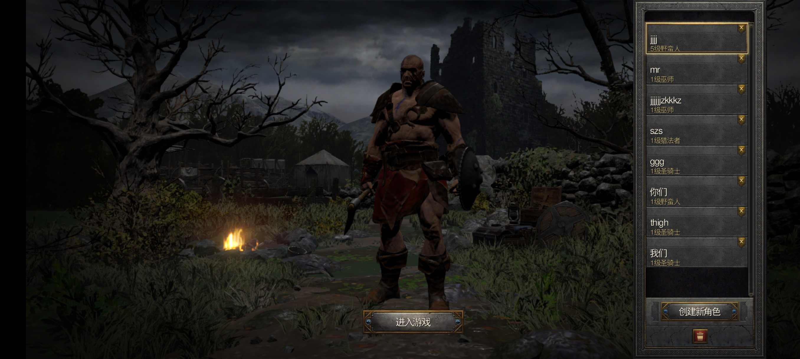
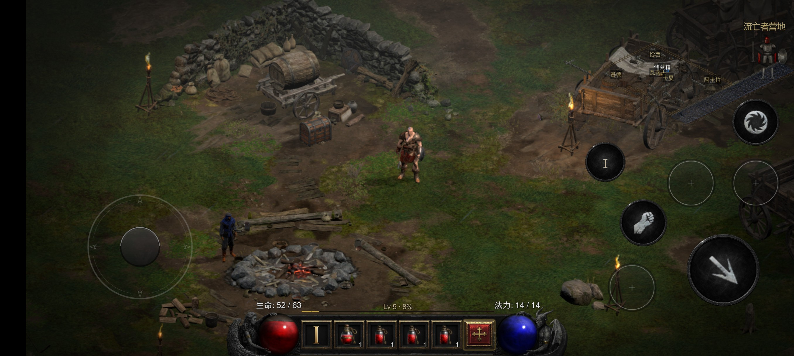

# D2R Mobile · Android

**Run the Nintendo Switch release of Diablo II: Resurrected (with the Reign of the Warlock expansion) that you own, natively, on an Android phone.** The game's own aarch64 program executes directly on the device with no emulated CPU; the platform services and graphics API are replaced by this repository's host layer, the graphics backend is reimplemented on Vulkan, and the shaders are translated offline.

中文: [README.android.zh-CN.md](README.android.zh-CN.md) · Main repository: [README.md](README.md) · Game files: [docs/GAME_FILES.md](docs/GAME_FILES.md)

> **Status: in development.** The Android build is fully playable (into a game, combat, saves, settings, the complete touch scheme), but it does not yet reach the iOS build's 60 fps — it currently measures **30–40 fps** depending on the resolution tier (see "Measured performance" below). The release target and the known limits are both documented here.

## Screenshots

*Character select (tap to pick a save slot from the list on the right)*



*In game: virtual stick bottom-left, skill wheel bottom-right, HUD and belt (camp, standard tier 2322×1080)*



---

## 1. What you need

### 1.1 Device

| Item | Requirement |
|---|---|
| OS | Android 10 or later (API 29+) |
| Architecture | arm64-v8a |
| Graphics | Vulkan 1.1 with a vendor driver (**Adreno tested**) |
| Memory | 6 GB or more recommended (the game's RomFS is about 8.4 GB; saves and the shader cache need space too) |
| Storage | 10 GB or more free recommended |

**Tested device**: Xiaomi 22081212C (Snapdragon 8+ Gen 1 / Adreno 730 / Android 16, 12 GB). Every performance figure in this document comes from that phone.

### 1.2 Game files

**You must own the game.** No game files are in this repository and none ever will be. You need the Switch release **1.0.34.0** (corresponds to PC **3.3.94012**), in two parts:

- Program files (ExeFS): `main`, `sdk`, `subsdk0` — about 26 MB
- Update package resources (RomFS): the `data/` directory — about 8.4 GB

See [docs/GAME_FILES.md](docs/GAME_FILES.md) for how to export them from your own console with nxdumptool. **The version must match**, otherwise the generation scripts stop with an error naming the mismatch instead of producing a broken build.

---

## 2. Building

### 2.1 Toolchain

| Dependency | Version |
|---|---|
| Android NDK | 27.2.12479018 |
| CMake | 3.22 or later |
| Ninja | any recent version |
| JDK | 17 or newer (any `javac`; packaging compiles with `-source 17`) |
| Python 3 | for asset generation and the verification scripts |

### 2.2 Steps

```bash
# 1) Generate assets and the ROMFS overlay (needs the game files above)
dm/android/tools/gen_overlay.sh
#    If assets were generated before and you only want to repackage:
#    DM_ASSETS_REUSE=1 dm/android/tools/gen_overlay.sh

# 2) Configure and build the native library (the build directory is not in the repository, so a new machine
#    configures it once)
SDK=${ANDROID_SDK_ROOT:-$HOME/Android/Sdk}
NDK=$SDK/ndk/27.2.12479018
cmake -S dm/android -B dm/android/build -G Ninja \
      -DCMAKE_TOOLCHAIN_FILE="$NDK/build/cmake/android.toolchain.cmake" \
      -DANDROID_ABI=arm64-v8a -DANDROID_PLATFORM=android-29 -DCMAKE_BUILD_TYPE=Release
cd dm/android/build && ninja
#    Configure checks for gen-assets/native_art/dm_touch_native_art.c from step 1; if the assets were generated
#    elsewhere, point DM_GEN_ASSETS=/path/to/gen-assets at them (or copy dm/android/build/gen-assets wholesale).

# 3) Package the APK (output: dm/android/build/apk/d2r-mobile-android-<version>+<build>.apk, e.g.
#    d2r-mobile-android-0.2-native-android-port+20261020.apk; the version comes from AndroidManifest.xml, the build number
#    defaults to today's date and can be overridden with DM_APK_BUILD)
#    The launcher icon reuses the iOS artwork (dm/ios/Assets.xcassets/AppIcon.appiconset/AppIcon1024.png) and is scaled to
#    five densities by tools/gen_icons.py at packaging time; no second copy is kept in the repository
dm/android/tools/build_apk.sh

# 4) Deploy to the device and launch
ADB=adb ANDROID_SERIAL=<your-device> dm/android/tools/deploy_apk.sh
```

`deploy_apk.sh` pushes the game data (RomFS and the shader cache) into the app's data directory, pushes the
coverage-table seed `dm/gfx/nvn/pass-coverage.tsv` next to the shaders (optional, `chmod 664` so the game can
read it), then installs and starts the APK. Layout:

```
/sdcard/Android/data/org.d2r.binaryprobe/files/d2r-mobile/
├── romfs-view/          game resources
├── shaders/             offline-translated shaders
├── diagnostics/         logs and diagnostic switches (see below)
└── ...
```

The first launch does a slower initial pass (unpacking and indexing resources); after that you are in a game about one second after the main menu.

### 2.3 Output name and packaging on another machine

The APK lands in `dm/android/build/apk/`:

```
d2r-mobile-android-<versionName>+<build>.apk
e.g. d2r-mobile-android-0.2-native-android-port+20261020.apk
```

- `<versionName>` is read from `dm/android/AndroidManifest.xml` (currently `0.2-native-android-port`), so there is no
  second source of truth; characters that do not belong in a file name (spaces, `/`) become `-`
- `<build>` defaults to **today's date** `YYYYMMDD` (two builds on the same day overwrite each other); pass
  `DM_APK_BUILD=a1 dm/android/tools/build_apk.sh` to tell them apart
- Intermediates use the same stem (`….aligned.apk`) — no more `dodola.*`; `deploy_apk.sh` with no argument picks
  the newest file in that directory

On another machine, satisfy these and the script finds everything else itself (environment variable first, then the
usual per-platform locations, then a plain-sentence error):

| Needed | How to provide it |
|---|---|
| Android SDK (aapt2/d8/zipalign/apksigner in build-tools, plus `platforms/android-*/android.jar`) | `ANDROID_SDK_ROOT` or `ANDROID_HOME`; otherwise it probes `~/Android/Sdk`, `~/Library/Android/sdk`, ... |
| JDK 17+ | `JAVA_HOME`; otherwise macOS `/usr/libexec/java_home`; otherwise derived from the `javac` on PATH |
| python3 + Pillow | generates the launcher icons (square and round, 5 densities each) |
| A built native library | `cd dm/android/build && ninja` first (NDK 27 + cmake + ninja) |
| Modules and generated assets | products of `build_modules.sh` / `gen_overlay.sh`; missing ones fail or warn explicitly |
| A signing key | defaults to `~/.android/debug.keystore` and is **created if absent** (standard debug spec); or set `DM_KEYSTORE=/path/to.jks` |

macOS's stock bash 3.2 and BSD `sort` (no `-V`) are both handled; no GNU tooling needed.


---

## 3. Controls

- **Touch**: the full scheme — virtual stick bottom-left, skill wheel bottom-right, a bottom bar with
  life/mana/experience/belt/town portal, layout that switches with panel state, skill glyphs and
  charge badges. Bluetooth and USB gamepads work at the same time.
- **Panels and menus**: the same structure as the iOS build; language follows the game setting
  (English / Chinese).
- Touch layout and geometry are produced by the generation scripts and checked by the contract test
  in section 6.

---

## 4. Quality and performance

### 4.1 Resolution tiers (Android only)

The Custom settings page has a **Resolution** row with three choices:

The three tiers are defined by **vertical pixels** (800p / 1080p / native); the width is derived from
the height times the SurfaceView aspect, so **no tier distorts the picture**. The world (3D) budget is
an **absolute megapixel figure**, from which the 3D scale is derived. The absolute numbers below are
from the tested phone (SurfaceView 2624×1220); other screens recompute with the same formula.

| Tier | Output (measured on a 2624×1220 screen) | World (3D) budget → actual | Measured frame interval (camp) |
|---|---|---|---|
| Power saver | 800p: 1720×800 (1.38 MP) | 0.85 MP → scale 0.786, 1352×629 | P50 24.8 ms, P95 40.5 ms (≈40 fps) |
| **Standard (default)** | 1080p: 2322×1080 (2.51 MP) | 1.10 MP needs scale 0.662, below the 0.70 floor → **clamped to 0.70**, 1.23 MP (1625×756) | P50 24.8–33.0 ms (30–40 fps) |
| High | panel native: 2624×1220 (3.20 MP) | 1.75 MP → scale 0.739, 1940×902 | P50 28.9–33.0 ms (30–35 fps) |

> The standard tier logs a yellow line on every start: `【黄】世界预算需 3D 比例 0.662 < 0.70，按 0.70 截断`
> ("world budget needs 3D scale 0.662 < 0.70, clamped to 0.70"). That is expected — the 0.70 floor keeps the
> world from getting too soft; the 1.10 MP budget only takes effect if the floor drops below 0.66.
>
> Thermal downscaling is **off by default** on Android (it needs `DM_3D_SCALE_DYN=1`): levels
> 0.85 / 0.80 / 0.75 / 0.70 / 0.65, floor 0.70. While it is off, the 3D scale is the fixed value in the
> table above. Details: [docs/android-resolution-plan.zh-CN.md](docs/android-resolution-plan.zh-CN.md), appendix 19.

Changing the tier requires restarting the game (the output resolution is fixed at startup).

Outside the Custom page you can also override with `diagnostics/quality.txt` (one line: `low` /
`standard` / `high`) or with `diagnostics/flag-*` (see `dm/android/app_jni.c` for the full list).
Priority: `DM_GAME_RES` / `DM_3D_SCALE` environment variables > `DM_QUALITY_TIER` > Custom page > default.

### 4.2 Measured performance (22081212C, camp scene)

External ruler `tools/pf/sf_fps.py` (SurfaceFlinger actual presentation timestamps), 2026-10-20, same
camp, three 15-second windows per tier:

| Tier (output / world) | Frame interval P50 | P95 | Effective |
|---|---|---|---|
| Power saver 1720×800 / 1352×629 | 24.8 ms | 40.5 ms | ≈40 fps |
| Standard 2322×1080 / 1625×756 | 24.8–33.0 ms | 33.1 ms | 30–40 fps |
| High 2624×1220 / 1940×902 | 28.9–33.0 ms | 33.1 ms | 30–35 fps |
| Standard + `DM_3D_SCALE=0.90` | 33.0 ms | 33.1 ms | ≈30 fps |

**Read this with one thing in mind**: the panel is 120 Hz, and present pacing lands on either 3 vsyncs
(≈25 ms) or 4 vsyncs (≈33 ms) — the "25 ms present cadence" comment in `dm/android/app_jni.c` is the
same thing. **The same tier switches between the two within minutes**, so a single 15-second window
cannot compare tiers: all of them sit in 30–40 fps and the differences are lost in measurement noise.
What can be stated:

- **Output pixels barely matter**: the power-saver output is 55% of the standard one, yet no stable
  difference in frame interval shows up — the bottleneck is **the serial work of one submission
  thread** (about 1,977 draws and 36,000 commands per frame, binding resolution the main cost; one
  render thread is saturated at 100%).
- **World scale**: raising the standard tier's 3D scale to 0.90 (world 1.23 → 2.03 MP) still measured
  the 33 ms band and showed no separate, slower regime — but neither did it reproduce the old claim
  that "0.722 → 0.90 holds the frame rate for 81% more pixels for free". For a sharper picture try
  `DM_3D_SCALE=0.85` and judge with a long-window A/B on your own phone (restart to apply).
- **Thermal effect**: after a long session the SoC throttles (measured: X2 dropping from 2.13 GHz to
  1.29 GHz) and the same scene loses another 3–5 fps (2026-10-19 standard-tier baseline: ~30 → ~27 fps).
  That is the device's thermal design, not a software regression.

### 4.3 Where the gap to iOS is

iOS holds 60 fps; Android currently sits at **30–40 fps** depending on the tier (high 30–35, standard
and power saver about 40). At the standard tier the bottleneck is not the GPU but **the serial work of
one submission thread** (about 1,977 draws and 36,000 commands per frame); with more world pixels
(3D scale above 0.90, or the high tier) it more often lands in the 30 fps band. Every optimisation tried and every one ruled out is recorded in
[docs/android-resolution-plan.zh-CN.md](docs/android-resolution-plan.zh-CN.md) (Chinese).

---

## 5. Diagnostics and tuning switches

Several files under `diagnostics/` can be used at runtime (**`chmod 666` them**, or the app cannot read
them):

| File | Purpose |
|---|---|
| `env.txt` | environment variables imported at start (one `KEY=VALUE` per line) |
| `quality.txt` | quality tier: `low` / `standard` / `high` |
| `flag-*` | preset switches (chunk size, scale, present rate, …) |
| `loadstore.txt`, `planstate.txt`, `prereset.txt`, `nooccl.txt`, `chunkd.txt`, … | **in-session A/B** switches: content 0/1 (or a step value), read once per statistics window, no restart needed |
| `enable-att-load-table` / `disable-att-load-table` | turn the per-pass `loadOp` coverage table on/off (default off; see appendix 20 of `docs/android-resolution-plan.zh-CN.md`) |
| `pass-sentinel` / `pass-sentinel-selftest` | sentinel probe used to fill the coverage table (slow, 7–18 fps; `selftest` proves the probe can report red) |

Frequently used environment variables:

| Variable | Effect |
|---|---|
| `DM_GAME_RES=1920x864` | set the output resolution directly |
| `DM_3D_SCALE=0.88` | set the world scale directly (0.70–1.0) |
| `DM_PROFILE_DETAIL=1` | enable the per-stage timers (`RENDER_*_PROFILE` lines) |
| `DM_VK_DEBUG=1` | enable the driver-side message callback (`VK_EXT_debug_utils`, no validation layer needed) |
| `DM_ATT_LOAD_TABLE=1` | enable the per-pass coverage table (seed: `dm/gfx/nvn/pass-coverage.tsv`, pushed next to the shaders by `deploy_apk.sh`) |
| `DM_PASS_SENTINEL=1` + `DM_PASS_SENTINEL_WINDOW=1` | fill the coverage table: sweep every pass index, 4 MB readback budget per submission |
| `DM_COV_MIN_SAMPLES=8` | independent green samples required before a key may be used (default 8; lower is more aggressive) |
| `DM_SUB_RING=0` | disable double-buffered submission contexts (on by default; for A/B) |
| `DM_UI_NO_QUERY=0` / `DM_SHADOW_NO_QUERY=0` | restore occlusion queries on the UI / shadow passes (skipped by default) |
| `DM_AFFINITY_ALL=1` | widen the render thread's affinity to every core (off by default) |

**Measure the frame rate with an external ruler**, not only the app's internal counter:

```bash
python3 tools/pf/sf_fps.py <serial> 20
# prints SurfaceFlinger presentation fps, interval P50/P95, dropped-frame rate, and the scene probe line
```

---

## 6. Verification scripts

```bash
python3 dm/i18n/scan_literals.py                  # user-facing literal check
python3 dm/ios/tests/test_touch_layout_options.py # touch layout contract (19 Android rows / 18 iOS rows)
bash dm/android/tools/sync_surface_audit.sh       # surface-sync audit (conflict surface stays 43)
```

---

## 7. Known limitations

- **Performance**: about 40 fps on the standard / power-saver tiers and 30–35 on high (cool camp
  scene), still short of iOS's 60 fps; the bottleneck is the single submission thread (section 4 and
  the linked plan document).
- **Validation layer**: not installed on the device; the built-in driver-side message callback stands
  in for it.
- **Address sanitizer**: `cmake -DDM_ASAN=ON` plus `DM_PACK_ASAN=1 dm/android/tools/build_apk.sh`
  builds an ASan variant (runtime packed into the APK) for memory-error hunting.
- **No game content is distributed**: neither the APK nor the repository contains game data.

---

## 8. Credits

**Without [@jhaizhou-ops](https://github.com/jhaizhou-ops) there would be no Android project at all.** He is
where the whole project starts: the very idea of running the Switch build's aarch64 program directly on a
phone host, the NVN interface takeover, the record/replay split, the offline shader translation chain, and the
touch and front-end layers all come from him: [jhaizhou-ops/d2r-mobile](https://github.com/jhaizhou-ops/d2r-mobile).
The Android port is an extension of that line, not a separate effort. His own line is mainly iOS / Mac (Metal).

On top of that there are two more layers:

- **[@dodola](https://github.com/dodola)** -- Android's graphical renderer: getting the native game host
  running on Android and building the **Vulkan replay backend** (the whole of `dm/gfx/nvn/nvn_vk.c`:
  replaying NVN's recorded command stream onto Vulkan, BC streaming coherence, comparison depth aliases,
  attachment feedback, upper-left origin mapping, device-local pipeline cache, 16 KB alignment). That is the
  ground Android's first frame of graphics stands on. On the UI side he built the very first skeleton
  (`GameActivity` / `TouchControlsView` prototypes) -- usable, but at the level of native widgets that simply
  display and respond to taps.
- **This branch (Android port, UI and performance)** -- on top of those two, most of the Android polish
  happened here:
  - **UI**: the bottom bar and the panels (stash, pouch, character select, skill atlas, minimap goal, ...),
    the new touch look and controls, the HUD, the custom settings page, resolution tiers, localisation.
    `touch_controls_android.c` grew from 125 to 442 lines and `TouchControlsView.java` from 78 to 465, with
    the great majority of the commits made on this branch.
  - **Performance**: pipeline warm-up with a self-learning manifest, attachment bandwidth cuts (camp
    917 -> 446 MB/frame), the translation queue and present pacing (camp 30 -> 36.6 fps), binding-plan and
    command-state caching, and optimisations along the pass/query/framebuffer lines.
  - The measurements and the decisions behind them are in
    [docs/ANDROID_PERF_NOTES.zh-CN.md](docs/ANDROID_PERF_NOTES.zh-CN.md) and
    [docs/android-perf-lessons.zh-CN.md](docs/android-perf-lessons.zh-CN.md); UI and iOS parity are covered in
    [docs/ANDROID_UI_PARITY.zh-CN.md](docs/ANDROID_UI_PARITY.zh-CN.md) (all Chinese).

Thanks also to upstream [deko3d](https://github.com/devkitPro/deko3d) (the block-linear layout and alignment
in `nvn_tex.c` are ported from it), [Ryujinx](https://github.com/Ryujinx/Ryujinx) (the shader translation
library) and [SPIRV-Cross](https://github.com/KhronosGroup/SPIRV-Cross) (SPIR-V to Metal Shading Language).

---

## 9. License

MIT. The game, its expansion, its assets and its trademarks belong to their respective owners. This
project only provides a compatibility layer that runs the game you own on your own device; it does not
provide or distribute any game files.
