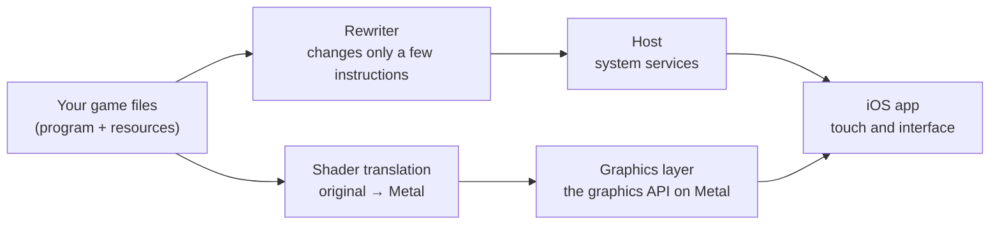

# D2R Mobile

**Una capa de compatibilidad de código abierto para iOS, macOS, Android y HarmonyOS que ejecuta Diablo II: Resurrected con la expansión Reign of the Warlock.** Lleva a iPhone, iPad y Mac, completa, la edición de Nintendo Switch que compraste, expansión incluida: el código original del juego se ejecuta de forma nativa, todos los controles se rehicieron para pantalla táctil, la tasa de fotogramas se mantiene en 60 fps y entras a una partida un segundo después del menú principal. Ahora también hay una versión nativa para macOS (primera versión): en un Mac con Apple silicon se abre con doble clic y funciona con teclado, ratón y mando. **Desde la v2.0 hay una versión para Android** (port de la comunidad): el mismo programa del juego se ejecuta de forma nativa en teléfonos Android ARM64, con los gráficos reimplementados sobre Vulkan; en un teléfono con Snapdragon 8+ Gen 1, el campamento y los combates de la Guarida del Mal y del Nivel de las Vacas van a una mediana de 60 fps (consulta «Android» más abajo); sobre el mismo motor hay una versión para HarmonyOS (port de la comunidad: un shell sin firmar de la página de Releases que firmas tú, sin compilar nada; consulta «HarmonyOS»). Apple TV 4K (3.ª generación, A15) cuenta con un port de la comunidad (versión preliminar para desarrolladores) que, hasta ahora, solo ha llegado a la pantalla de selección de personaje en el dispositivo de su autor; consulta la tabla de dispositivos más abajo.

Esto no es una demo técnica que «más o menos funciona». Es una versión móvil pulida para jugar a diario, desde tu primer personaje hasta el contenido de fin de juego.

Plataformas: iPhone / iPad (iOS 26 o posterior; iOS 18 – 25 con la compilación para API antiguas) · Mac (Apple silicon, macOS 26 o posterior; macOS 15 – 25 con la compilación para API antiguas) · Apple TV 4K (3.ª generación, A15; port de la comunidad, versión preliminar para desarrolladores) · Teléfonos Android (ARM64, Android 12 o posterior, Vulkan 1.1; port de la comunidad) · Teléfonos HarmonyOS (HarmonyOS NEXT; port de la comunidad, shell sin firmar de la página de Releases que firmas tú) · Versión del juego: edición de Switch con Reign of the Warlock, 1.0.34.0 (corresponde a la versión de PC 3.3.94012) · Español / English / 中文 / Русский / 한국어 · Licencia: MIT · **Aporta tus propios archivos del juego**

English: [README.md](README.md) · 中文: [README.zh-CN.md](README.zh-CN.md)

<p align="center">
  
</p>
<p align="center">
  
  
</p>

| 100% | 60 fps | aprox. 1 s | aprox. 3,8 W |
|:---:|:---:|:---:|:---:|
| La jugabilidad original, porque es el programa original | Estables, sin caídas una vez que el dispositivo se calienta | Del menú principal a una partida | Consumo de todo el dispositivo a 60 fps |

## Qué es y qué no es

**Es:**

- El propio programa aarch64 del juego, **ejecutándose directamente en el dispositivo**, sin CPU emulada. iPhone y Switch usan la misma clase de procesador; solo se reescriben las pocas instrucciones que no pueden ejecutarse sin cambios bajo el kernel de Apple, y todos los demás bytes del programa quedan exactamente como se publicaron. Todas las clases, todas las palabras rúnicas (Runewords), las zonas de terror (Terror Zones), los jefes, las reglas de botín y el desarrollo de las misiones son idénticos al original.
- Los servicios de plataforma que el juego espera —llamadas al sistema, sistema de archivos, API gráfica, audio, entrada— los proporciona un pequeño anfitrión (host) escrito para las plataformas de Apple. La API gráfica está reimplementada por completo —sobre Metal en los dispositivos de Apple y sobre Vulkan en Android—, sin ninguna capa de emulación en medio, y los shaders se traducen sin conexión a partir de los originales del juego.
- Un port pensado para teléfonos y llevado hasta el final: un esquema de control táctil completo, pantalla de borde a borde en iPhone y pantalla completa real en iPad, compatibilidad con mandos, modo de ahorro de energía, sincronización de partidas guardadas, cinco idiomas (inglés, chino, español, ruso y coreano), y todo un conjunto de modos de fin de juego y mejoras de calidad de vida que el original nunca tuvo.

**No es:**

- Un emulador, juego en la nube ni streaming.
- **Una fuente de contenido del juego. No contiene ninguno ni distribuye ninguno.** En este repositorio no hay programa del juego, arte, textos, tablas de datos ni shaders; todo eso se genera en tu propia máquina a partir de tus propios archivos (consulta [docs/GAME_FILES.md](docs/GAME_FILES.md) (en inglés)). Lo que sí incluye el repositorio es la información de interfaz que registramos para que el port funcione —descripciones de interfaz de los shaders, la tabla de funciones de la API gráfica, direcciones dentro del programa y similares—, detallada elemento por elemento en [docs/DERIVED.md](docs/DERIVED.md) (en inglés).
- En línea. No hay multijugador; el juego funciona totalmente sin conexión y no necesita ninguna cuenta en línea.

## Probado a fondo

Los **44** iPhone y iPad de la beta cerrada —35 dispositivos registrados para instalación directa (25 iPhone y 10 iPad), más 9 cuentas de TestFlight con un dispositivo cada una— **completaron Normal, Pesadilla e Infierno con varios personajes**, y la experiencia fue excelente. Desde un iPhone 14 Pro Max con 6 GB de memoria hasta el iPad Pro más reciente, ningún dispositivo se quedó atrás.

| | Modelos |
|---|---|
| iPhone | 14 Pro Max, 15, 15 Pro, 15 Pro Max, 16 Plus, 16 Pro, 16 Pro Max, 17 Pro Max y más |
| iPad | iPad Air, iPad mini, iPad Pro de 11 pulgadas y de 12,9 / 13 pulgadas (incluidos M2 y M4) y más |
| Modelo más modesto probado | **iPhone 14 Pro Max (A16, 6 GB): 60 fps impecables** |

iPhone y iPad comparten un único paquete de instalación.

<p align="center">
  
  
  
  
  
</p>

## Rápido, fluido y amable con la batería

Medido en un dispositivo real (iPhone 17 Pro Max):

| Elemento | Lectura |
|---|---|
| Tasa de fotogramas en partida | **60 fps**, estables, sin caídas una vez que el dispositivo se calienta |
| Apertura de la app | 0,15 s |
| Hasta el menú principal | aprox. 1 s |
| Del menú principal a una partida | **aprox. 1 s** |
| Quick Restart (reinicio rápido), de vuelta en partida | aprox. 1,2 s |
| Fotograma más largo al cambiar de acto | aprox. 0,1 s |
| Consumo de todo el dispositivo, 60 fps | **aprox. 3,8 W** (en el campamento, brillo al 50%): casi 5 horas de juego continuo con una carga completa |
| Consumo de todo el dispositivo, modo de ahorro de energía a 30 fps | **aprox. 1,85 W**, cerca de la mitad que a 60 fps, para aproximadamente el doble de autonomía |

<sub>Condiciones de medición: el consumo es el de todo el dispositivo, medido el 2026-10-10 en un iPhone 17 Pro Max, de pie en el campamento del Acto I con el brillo al 50%; los 60 fps y el modo de ahorro de energía se midieron en la misma escena. La autonomía se calcula a partir del consumo medido y la capacidad de la batería, no jugando de carga completa a vacía. Los tiempos de apertura y de entrada a partida se midieron en el mismo modelo en 2026-10; las lecturas de tasa de fotogramas y de cambio de acto se tomaron en el mismo modelo el 2026-10-12 recorriendo zonas y cambiando de acto tras entrar en una partida.</sub>

El paquete de instalación ocupa apenas algo más de 100 MB. Los recursos del juego (unos 5,6 GB) se colocan en el teléfono por separado, y actualizar la app no toca ni tus partidas guardadas ni los recursos.

Por qué es tan rápido: el programa se ejecuta de forma nativa y ni una sola instrucción pasa por emulación; los gráficos van directamente a Metal; todos los shaders se traducen sin conexión y se compilan de antemano, así que no se compila nada al entrar en una escena nueva. Los chips más antiguos (A16 y anteriores, como la familia iPhone 14 y el iPhone 15) no admiten el formato de texturas comprimidas original del juego; necesitan un paquete de texturas adicional creado a partir de tus propios archivos del juego, y con él también funcionan a la tasa de fotogramas completa; consulta [docs/LEGACY_DEVICES.md](docs/LEGACY_DEVICES.md) (en inglés).

## Rediseñado para los dedos

Esto no es un mando pegado sobre la pantalla. Cada panel y cada acción se rehicieron para los dedos con un único principio de diseño: **conservar el lenguaje de interfaz original y usar gestos en lugar de añadir botones a la pantalla**. El tamaño del texto y de las zonas táctiles está pensado para los dedos. Sabes jugar en cuanto lo tomas en tus manos, y sigue siendo cómodo en sesiones largas.

<p align="center">
  
  
</p>

- **Moverse**: un joystick virtual con diagonales precisas; toca a un PNJ o el suelo para ir hasta allí automáticamente; las puertas, los portales y las entradas de cuevas se pueden tocar en toda su superficie.
- **Combatir**: pulsa un botón de habilidad para lanzarla, mantenlo pulsado para seguir lanzándola, **arrastra para apuntar en cualquier ángulo**; los monstruos cercanos se seleccionan automáticamente. Dos juegos de habilidades. Las habilidades de tus armas secundarias se lanzan con un solo toque —el juego cambia de arma, lanza la habilidad y vuelve a cambiar— y el botón muestra las cargas restantes.
- **Barra de vida del jefe**: fija en la parte superior de la pantalla, con el porcentaje restante.
- **Objetos**: tocar, tocar dos veces, mantener pulsado y arrastrar y soltar siguen a tu dedo. Toca dos veces una pieza de equipo para equiparla o quitártela; arrastra un objeto a cualquier parte del panel del vendedor para venderlo; en una pila, tocar dos veces toma 1 y mantener pulsado toma 3; mantén pulsada una casilla vacía del inventario para ordenarlo todo.
- **Texto**: se escribe con el teclado del sistema. Los nombres de personaje pueden estar en chino; deja el nombre en blanco para obtener uno aleatorio.
- **Pantalla**: en iPhone, la pantalla 19,5:9 se llena de borde a borde, sin chocar con la muesca ni con las esquinas redondeadas; en iPad, el juego ocupa toda la pantalla y la interfaz se centra sola al abrir un panel; la imagen 3D se puede aclarar.

### Mando

Conecta un mando y pulsa cualquier botón: la interfaz cambia a la distribución original para mando, con indicaciones de botones en la parte inferior de cada panel. Toca la pantalla y vuelves al instante a la interfaz táctil. El inventario, el alijo (Stash), el árbol de habilidades, la Chronicle y los ajustes se pueden manejar por completo con el mando, con la misma asignación de botones que en Switch. Con un mando de Xbox, la asignación cambia sola a la de la versión de PC / Xbox (abajo confirma, derecha vuelve atrás) y las indicaciones muestran los iconos de botones de Xbox; no hay que activar nada. Con un mando de PlayStation (DualSense o DualShock 4), las indicaciones cambian a los iconos de PlayStation del propio juego (✕ confirma, ○ vuelve atrás); lo aportó [@Ti800](https://github.com/Ti800) ([#119](https://github.com/jhaizhou-ops/d2r-mobile/pull/119)).

<p align="center">
  
  
</p>

## Nuevas formas de jugar, sobre la base del original

Terminar el juego original es solo el principio. Sin tocar las reglas originales, añadimos todo un conjunto de contenido de fin de juego que te mantiene farmeando.

### Greater Rift

Se entra por el portal rojo de Harrogath tras completar Infierno. Hay 100 niveles y los monstruos se hacen más fuertes en cada uno; llena la barra de progreso y derrota al Rift Guardian en menos de 15 minutos para superar un nivel. Cada 2 niveles superados otorgan +1 punto de habilidad y +5 puntos de atributo, y el límite de nivel de las habilidades sube de 20 a 40. Cada 10 niveles hay una recompensa por la primera vez que lo superas, y superar el nivel 10 desbloquea seis nuevas ranuras de equipo para tu mercenario.

<p align="center">
  
  
</p>

### Endgame Boss Rush, modo Elysium y el Kill Board

- **Endgame Boss Rush** (desafío de jefes de fin de juego): se desbloquea tras completar Infierno y tiene 12 fases; la fase 11 es Diablo Clone y la fase 12 son los tres jefes Uber.
- **Modo Elysium** (se elige al crear el personaje): objetos únicos ×5, objetos de conjunto ×3, runas ×5; la probabilidad de «no soltar nada» se reduce a una décima parte, y los jefes siempre sueltan botín como en la primera vez que los matas.
- **Kill Board** (tablero de muertes): para cada jefe, el número de muertes, la hora de la primera muerte, cuántos objetos únicos y de conjunto ha soltado, y tus tiempos de muerte mejor y promedio.

<p align="center">
  
  
</p>

### Almacenamiento: el paraíso del coleccionista

- **Alijo Chronicle**: cada objeto único y de conjunto identificado tiene su propia casilla fija, compartida por todos los personajes, con búsqueda y con depósito y retirada; el botón Deposit envía allí con un solo toque los objetos únicos y de conjunto de tu inventario y del Cubo horádrico.
- **Alijo (Stash)**: ampliado a 14 columnas, con 5 páginas personales y 5 páginas compartidas.
- **Trove**: las páginas de gemas, runas y materiales fusionadas en una sola, con la cuadrícula de creación del Cubo horádrico en el centro, para que encontrar cosas y crear objetos ya no implique ir saltando entre páginas. Las runas, gemas y materiales que pongas en las páginas personales o compartidas se archivan aquí automáticamente.
- **Pouch**: un inventario ampliado. Las runas y gemas que encuentres por el mundo van a él automáticamente y no ocupan espacio en el inventario.

<p align="center">
  
  
</p>

### Farmeo sin esfuerzo

| | |
|---|---|
| Relanzamiento automático de mejoras | Las habilidades de mejora (buffs) que has aprendido no necesitan una ranura en la barra de habilidades: cuando una mejora se agota, se vuelve a lanzar en cuanto te quedas quieto; las mejoras que vienen de tus armas secundarias (como Battle Orders de Call to Arms) cambian de arma, se relanzan y vuelven a cambiar solas |
| Pociones y cinturón | El consumo automático tiene dos niveles: una poción de curación por debajo del 50% de vida y una poción de rejuvenecimiento por debajo del 30%; **tu mercenario recibe pociones automáticamente con la misma regla**. Las pociones del suelo se recogen automáticamente cuando hay espacio en el cinturón; toca dos veces una casilla vacía del cinturón para rellenarlo entero |
| Filtro de botín | A partir de Pesadilla, el filtro de botín original se activa automáticamente para ocultar lo que estorba: filtrado ligero en Pesadilla, intenso en Infierno |
| Recogida automática | Las runas y gemas de bajo nivel van directamente al Pouch; las de alto nivel se dejan para que las recojas tú |
| Avisos de botín valioso | Las runas de alto nivel y los objetos únicos levantan un haz de luz y caen con un sonido distinto; el teléfono vibra con una de tres intensidades —suave, media o fuerte— según su valor |
| Asistente de palabras rúnicas | Mantén pulsada una base con engarces para ver las palabras rúnicas que puede formar y sus atributos; cuando tengas las runas, engárzalas todas con un solo toque |
| Guía en el minimapa | Cada mapa marca su Waypoint y sus salidas, con el nombre del Waypoint y de la zona a la que lleva cada entrada (iOS / Mac); cada objetivo de misión aparece en el mapa; cuando un objetivo está fuera de la pantalla, su nombre se escribe a lo largo del borde |
| Tareas tediosas eliminadas | Identificación gratuita, Town Portal gratuito sin necesidad de pergaminos, aparición justo al lado del Waypoint, Quick Restart, mercancía de los vendedores renovable, redistribución gratuita e ilimitada con Akara |
| Partidas guardadas | Se guardan de inmediato al cambiar de app, al cerrarla deslizando o al salir; sincronización por iCloud entre dispositivos (requiere firmar con una cuenta de desarrollador de pago) |
| Modo de entretenimiento (experimental) | Cámara sobre el hombro y en primera persona: arrastra la mitad derecha para mirar alrededor, flechas para los monstruos fuera de la imagen y un indicador de orientación en el mapa ([detalles](docs/over-the-shoulder-camera.md); con [@yyan160](https://github.com/yyan160), [#165](https://github.com/jhaizhou-ops/d2r-mobile/pull/165)) |

La mayoría de las funciones se pueden activar o desactivar una por una en el juego, en Options → Custom.

<p align="center">
  
  
  
</p>

### Español, inglés, chino, ruso y coreano

Todo el juego cambia entre español, inglés, chino, ruso y coreano en Opciones → Extras; tras reiniciar, la interfaz queda en el idioma que elegiste. La primera vez que lo abres sigue el idioma de tu dispositivo (el español de España usa los textos esES del juego y el de otras regiones, los textos latinoamericanos esMX; el ruso usa los textos ruRU). En español, ruso y coreano, los objetos, las habilidades y los monstruos usan la terminología oficial del juego, y todo lo que añadimos —Grieta superior, Crónica, la página de ajustes, las indicaciones de gestos y los rótulos del mapa— también está traducido (las notas de objetos solo existen en chino y español). El ruso es el texto ruRU del juego y el coreano su texto koKR, sin variantes regionales. Voces: en español quedan en inglés; en ruso y en coreano se usan las voces rusas o coreanas originales si tus archivos del juego las incluyen (un paquete hecho con los datos completos del juego las trae) y, si no, en inglés; en chino, voces en chino. El coreano lo aportó [@soulsakura](https://github.com/soulsakura) ([#118](https://github.com/jhaizhou-ops/d2r-mobile/pull/118)).

<p align="center">
  
  
</p>

## Cómo funciona



| Parte | Dónde | Qué hace |
|---|---|---|
| Reescritor del programa | `dm/tools/patch_nso.py` | Reescribe solo las pocas instrucciones que no pueden ejecutarse sin cambios bajo el kernel de Apple (registros de puntero de hilo, llamadas al sistema, temporizadores) y deja el resto del programa byte a byte como se publicó |
| Anfitrión (host) | `dm/host` | Carga el programa reescrito y proporciona los servicios de plataforma a los que llama |
| Gráficos | `dm/gfx` | Implementa la API gráfica del juego sobre Metal; los shaders se traducen sin conexión a partir de los originales del juego |
| App de iOS | `dm/ios` | El contenedor de la app, los controles táctiles y la interfaz |
| App de Android | `dm/android` | El contenedor de Android, la capa táctil y la presentación con Vulkan |
| App de HarmonyOS | `dm/harmony` | El contenedor de HarmonyOS (ArkTS + N-API), que comparte el anfitrión y el motor Vulkan con Android |
| Gráficos con Vulkan | `dm/gfx/vulkan` | La misma API gráfica sobre Vulkan (lo comparten Android y HarmonyOS; el motor viene del port a HarmonyOS) |
| Verificación | `dm/verify` | Comprueba que el código reescrito se comporta exactamente igual que el original, además de las barreras de regresión por las que pasa cada cambio |

**Por qué puedes confiar en él:** la estabilidad no es cuestión de suerte. Las herramientas de pruebas y verificación forman parte del proyecto: pruebas unitarias para el anfitrión y la capa gráfica, una comprobación de equivalencia para cada instrucción reescrita, regresión con recorridos automatizados por script para la interfaz táctil y pruebas de humo en dispositivos reales. Empieza por `make -C dm/host/tests run`, `make -C dm/gfx/tests run` y `dm/verify/regress.sh` (ejecútalos dentro del entorno de Python preparado en el paso 2 más abajo; `regress.sh` además necesita `brew install llvm`). Cómo contribuir se explica en [CONTRIBUTING.md](CONTRIBUTING.md) (en inglés).

## Android (nuevo en la v2.0)

Los teléfonos Android usan procesadores ARM64, igual que la Switch, así que, como en los dispositivos de Apple, el propio programa del juego se ejecuta directamente en el teléfono, sin emular la CPU. Esta versión lleva a Android todo el anfitrión —llamadas al sistema, sistema de archivos, audio, entrada, partidas guardadas— sin cambios y sustituye la capa gráfica por Vulkan: el motor de reproducción NVN→Vulkan viene del port a HarmonyOS de [@biglawine](https://github.com/biglawine), y la app de Android, los controles táctiles, la presentación con Vulkan y una ronda completa de optimización, medida paso a paso en un teléfono, son obra de [@yyan160](https://github.com/yyan160) ([#113](https://github.com/jhaizhou-ops/d2r-mobile/pull/113)). Las versiones de Apple y de Android comparten el mismo código del anfitrión, así que los cambios futuros benefician a ambas.

Medido por los autores del port en sus teléfonos (ajustes por defecto del producto: escala de renderizado 3D limitada a 0.85 y reducida dinámicamente cuando se pierden fotogramas):

| Teléfono | Resultado |
|---|---|
| Redmi K50 Ultra (Snapdragon 8+ Gen 1, Adreno 730, Android 15) | Campamento, combate en la Guarida del Mal, combate en el Nivel de las Vacas: **mediana de 60 fps**, GPU unos 14–15 ms por fotograma |
| OnePlus 13 (Adreno 830) | Jugable; cuando aparece cierto efecto de luz en el campamento, a veces parpadean durante un instante pequeños cuadros negros (en investigación) |

Requisitos mínimos: ARM64, Android 12 (API 31) o posterior y una GPU con Vulkan 1.1.

**Cómo usarlo hoy**: instala `D2RMobile-android.apk` desde la página de versiones (no contiene ningún contenido del juego). En un ordenador, ejecuta `python3 dm/tools/d2rm_android.py <directorio Update> <directorio de salida>` con tus propios archivos del juego para crear el paquete de importación (una carpeta `android` con el programa del juego reescrito, todos los paquetes de shaders de Vulkan, la capa táctil y algunas tablas de datos) y cópialo junto con los recursos del juego (la carpeta `data`) a `Download/S2X/D2R Mobile/` en el teléfono. La app lo importa con una pantalla de progreso al abrirla. Sin adb y sin compilar el APK tú mismo. Los pasos completos están en [docs/ANDROID.md](docs/ANDROID.md) (en inglés). Los controles táctiles se dibujan igual que en iPhone (bases de botón, siluetas plateadas de habilidades, joystick) y ya no hay botones virtuales de mando sobre los paneles abiertos. Frente a la versión de iOS faltan algunos detalles táctiles: el menú de las casillas de habilidad vacías, la superposición para repartir puntos y la imagen del objeto que sigue al dedo al arrastrar en una tienda.

El progreso, las mediciones de cada ronda y el trabajo pendiente están en [docs/ANDROID_COLLABORATION.md](docs/ANDROID_COLLABORATION.md) y [docs/android-notes/](docs/android-notes/) (en inglés). La versión para HarmonyOS está en la sección siguiente.

## HarmonyOS (nuevo en la v2.0)

La app para HarmonyOS NEXT (`dm/harmony`) es de [@biglawine](https://github.com/biglawine) ([#114](https://github.com/jhaizhou-ops/d2r-mobile/pull/114)) y usa el mismo anfitrión y el mismo motor Vulkan que Android. Medido por el autor en un Mate 90 Pro Max (Maleoon 955): 59,7 fps manteniendo el joystick en el campamento del Acto I, intervalo de pantalla p50 16,6 / p99 18,1 ms.

**Cómo usarla**: la misma idea que el shell de iOS. La página de Releases tiene un **paquete de instalación sin firmar que no contiene nada del juego** (`D2RMobile-harmony-shell-unsigned.hap`). HarmonyOS NEXT solo instala apps firmadas con tu propio certificado de desarrollador, así que lo vuelves a firmar con tu certificado de depuración y lo instalas; no tienes que compilar la app. Después, en un ordenador, ejecuta `python3 dm/tools/d2rm_android.py --target ohos <carpeta Update> <carpeta de salida>` sobre tus propios archivos del juego para crear el paquete de ejecución, ponlo junto con los recursos del juego en una carpeta «D2R Mobile» del teléfono, abre la app y elige esa carpeta para importarla. Los pasos completos están en [docs/HARMONYOS.md](docs/HARMONYOS.md) (en inglés). El autor completó toda la cadena (firmar → instalar → primera importación → entrar en partida → guardar y salir) en un Mate 90 Pro Max, con tres arranques en frío seguidos sin problemas; necesitas una cuenta de desarrollador de Huawei (DevEco Studio puede generar el certificado de depuración y registrar el dispositivo por ti).

## Qué dispositivos son compatibles

Mínimo: **un chip A14 / M1 o posterior**: la capa gráfica necesita Metal 3, que Apple admite a partir de A14 / M1 (consulta [Metal support on Apple devices](https://support.apple.com/102894) y [Metal Feature Set Tables](https://developer.apple.com/metal/Metal-Feature-Set-Tables.pdf) de Apple).

| Dispositivo | ¿Se puede jugar? | Cómo | Qué tan seguros estamos |
|---|---|---|---|
| **iPhone / iPad, A17 Pro y posteriores** (iPhone 15 Pro y posteriores, iPhone 16 y posteriores, iPad con chips de la serie M) | Sí | iOS 26 o posterior: el contenedor predeterminado / la compilación predeterminada; iOS 18 – 25: el contenedor para iOS 18 / la [compilación para API antiguas](docs/OLDER_SYSTEMS.md) (en inglés) | Dispositivos principales, jugados a diario |
| **iPhone Duo** (plegable) | Sí; la imagen cambia de tamaño al desplegarlo o plegarlo | Los shells de la página de Releases se compilan con Xcode 27.1; si lo compilas tú con Xcode, usa la 27.1 para que la pantalla interior se llene (consulta [docs/DEPENDENCIES.md](docs/DEPENDENCIES.md), en inglés) | Compatible desde la v2.0. Comprobado en un Mac alternando entre los tamaños de la pantalla exterior e interior que da el simulador de iPhone Duo (el simulador no puede ejecutar los gráficos del juego). Lo probaremos en un iPhone Duo real en cuanto tengamos uno; si tienes uno, cuéntanos en un Issue cómo te va |
| **iPhone / iPad, A16 y anteriores** (todos los modelos de iPhone 14, iPhone 15 / 15 Plus, serie iPhone 13, etc.) | Sí, con un paso adicional | Crea un Legacy Device Pack (paquete para dispositivos antiguos) a partir de tus propios archivos del juego como se indica en [docs/LEGACY_DEVICES.md](docs/LEGACY_DEVICES.md) (en inglés) e inclúyelo al crear el paquete de instalación; la división por sistema es la misma que en la fila anterior | Jugado por jugadores: iPhone 14 Pro Max (A16, 6 GB) a 60 fps; iPhone 13 Pro Max (A15, 6 GB) en el modo de 30 fps |
| **Dispositivos con 4 GB de RAM** (como el iPad mini de 6.ª generación o el iPad Air de 4.ª generación) | Funciona, pero la memoria va muy justa (seguimos reduciendo el uso de memoria) | Igual que la fila de A16 y anteriores (con el Legacy Device Pack) | Probado por un jugador: en un iPad mini 6 (A15, 4 GB, iPadOS 27), unos minutos del Acto I funcionaron a 50–58 fps tras la reducción automática de calidad, con avisos constantes de memoria del sistema y a solo unos 560 MB por debajo del límite de memoria del sistema; las escenas cargadas, con muchos monstruos y efectos, pueden ser cerradas por el sistema. En una versión anterior, un iPad Air 4 (A14, 4 GB) fue cerrado por el sistema unos segundos después de abrirse |
| **Chips A14 con 6 GB de RAM o más** (como el iPhone 12 Pro / 12 Pro Max) | Aún no hay reportes | Igual que la fila de A16 y anteriores | Si lo has probado, abre un Issue y cuéntanos |
| **Chips A13 y anteriores** (como la serie iPhone 11 y el iPad Pro de 2020) | No compatible | — | El chip gráfico no admite Metal 3 (probado por un jugador en un iPad Pro con A12Z; las referencias de Apple están encima de la tabla); la app lo indica al abrirse en lugar de cerrarse inesperadamente |
| **Mac, Apple silicon** | Sí (App nativa de macOS) | macOS 26 o posterior: la compilación predeterminada; macOS 15 – 25: la [compilación para API antiguas](docs/OLDER_SYSTEMS.md) (en inglés). Teclado, ratón y mando funcionan; lo que puede hacer cada uno está en [docs/MAC.md](docs/MAC.md) (en inglés) | Un jugador ha jugado con la compilación para API antiguas en macOS 15.7.7 |
| **Apple TV 4K (3.ª generación, A15)** | Port de la comunidad ([@yinqingyan](https://github.com/yinqingyan), aportado bajo la licencia MIT con el consentimiento del autor), versión preliminar para desarrolladores | Compílalo como se indica en [dm/tvos/README.md](dm/tvos/README.md) (en inglés) y copia los archivos del juego y el Legacy Device Pack dentro de la app; solo en hardware real, el Simulador no puede ejecutarlo; las partidas guardadas viven en el directorio Caches, que el sistema puede vaciar | Llegó a la pantalla de selección de personaje en hardware real; entrar en la partida, la asignación completa del mando y las partidas guardadas aún no están verificados, y los mantenedores no lo han probado en hardware real |
| **Teléfonos HarmonyOS** (HarmonyOS NEXT, API 26) | Se puede jugar (port de la comunidad) | El shell sin firmar de la página de Releases, firmado con tu certificado de depuración, más un paquete de ejecución hecho con tus archivos del juego; consulta [docs/HARMONYOS.md](docs/HARMONYOS.md) (en inglés) | Verificado por el autor en un Mate 90 Pro Max: firmar, instalar, importar, entrar en partida, guardar y salir |
| **Teléfonos Android** (ARM64, Android 12 o posterior, Vulkan 1.1) | Se puede jugar (port de la comunidad) | El APK de la página de versiones + un paquete de importación creado con tus propios archivos del juego; consulta [docs/ANDROID.md](docs/ANDROID.md) (en inglés) | Medido por los autores del port: Redmi K50 Ultra, mediana de 60 fps; OnePlus 13 jugable, con pequeños cuadros negros que a veces parpadean un instante; probado en un vivo X200 Ultra |
| **Mac con Intel** | No compatible | — | — |

**Qué significan los diálogos de la App**

- **"One More Step for This Device"** («Un paso más para este dispositivo»): este teléfono puede ejecutar el juego; el paquete de instalación se creó sin el Legacy Device Pack. Crea el paquete como se indica en [docs/LEGACY_DEVICES.md](docs/LEGACY_DEVICES.md) (en inglés), vuelve a crear el paquete de instalación con él y reinstala.
- **"Device Not Supported … iPhone 15 Pro and later can play"** («Dispositivo no compatible… se puede jugar en iPhone 15 Pro y posteriores»): es el texto antiguo de antes de la v1.0.9. Tienes una versión antigua; actualiza a la más reciente. En dispositivos A16 y anteriores, sigue después el punto anterior.

**Qué no tiene un paquete que compilas tú mismo, en comparación con las compilaciones de nuestro grupo de pruebas**: la versión pública se puede compilar e instalar con un Apple ID gratuito. Tres cosas de las compilaciones de nuestro grupo de pruebas no están en ella: la sincronización de partidas guardadas por iCloud (la App necesita el permiso de firma de iCloud, que un paquete autofirmado no tiene), la descarga de paquetes y recursos dentro de la App, y los avisos de nueva versión (estas dos usan nuestro propio servidor). El juego en sí y las funciones que añadimos son los mismos.

## Primeros pasos

Juegues en el dispositivo que juegues, empiezas con **los archivos del juego que compraste**: la edición de Switch de Diablo II: Resurrected más la expansión Reign of the Warlock, actualizada a la 1.0.34.0 (la versión que muestra la consola; corresponde a la versión de PC 3.3.94012, y los nombres de directorio y las herramientas de este repositorio usan este último número). Este proyecto está hecho para la versión con esa expansión; usarlo sin la expansión no está soportado ni se ha verificado. Cómo prepararlos se explica en [docs/GAME_FILES.md](docs/GAME_FILES.md) (en inglés).

> Este proyecto proporciona únicamente herramientas y un contenedor de instalación que no contiene ningún contenido del juego. No distribuimos ni respaldamos, y no nos hacemos responsables de, ningún tercero que distribuya recursos del juego, ejecutables del juego o paquetes de instalación que contengan contenido del juego. Usa únicamente archivos del juego que poseas legalmente.

Este proyecto está implementado y verificado sobre la edición de Switch 1.0.34.0 (que corresponde a la versión de PC 3.3.94012), y por defecto las herramientas solo aceptan esa versión. Usuarios de la comunidad han informado de que adaptaron otras versiones por su cuenta siguiendo la estructura de este repositorio y que las ejecutaron con éxito. Las tablas de reglas están agrupadas por versión del juego (en `dm/tools/patch_nso.py`, indexadas por el build ID del programa principal); te invitamos a contribuir con la versión que hayas adaptado.

**Primero revisa tu dispositivo** y busca tu sección en la tabla de abajo; la tabla «Qué dispositivos son compatibles» de arriba te indica qué compilación usar en dispositivos de Apple y si además necesitas un Legacy Device Pack.

| Tu dispositivo | Cómo | Pasos |
|---|---|---|
| iPhone / iPad, con un Mac con Apple silicon | Una compilación completa desde el código fuente | «Con un Mac: tres pasos», más abajo |
| iPhone / iPad, sin Mac | Descarga un contenedor sin contenido del juego y añade tu contenido en Windows / Linux | «Sin un Mac», más abajo, y [docs/NO_XCODE.md](docs/NO_XCODE.md) (en inglés) |
| Mac (Apple silicon) | Compila una App nativa de macOS | «Jugar directamente en un Mac», más abajo, y [docs/MAC.md](docs/MAC.md) (en inglés) |
| Teléfono Android | Instala el APK de la página de versiones y copia al teléfono un paquete de importación creado en una computadora | «Android», más abajo, y [docs/ANDROID.md](docs/ANDROID.md) (en inglés) |
| Teléfono HarmonyOS | Firma el shell sin firmar de la página de Releases con tu certificado de depuración, crea un paquete de ejecución en un ordenador y cópialo al teléfono | «HarmonyOS», más abajo, y [docs/HARMONYOS.md](docs/HARMONYOS.md) (en inglés) |

Las dos rutas para iPhone / iPad, comparadas:

| | Con un Mac | Sin un Mac |
|---|---|---|
| Computadora | Un Mac con Apple silicon y Xcode instalado | Windows / Linux / un Mac sin Xcode |
| Método | Una compilación completa desde el código fuente | Descarga un «contenedor» (shell) sin contenido del juego, usa la herramienta de empaquetado para añadir tu propio contenido del juego y luego instálalo con una herramienta de sideloading (instalación externa) |
| Estado | La ruta principal; todo lo anterior proviene de ella | Funciona de principio a fin en Windows, desde crear el paquete hasta jugar en un dispositivo, y el programa del juego generado en los dos sistemas es idéntico byte a byte; el único paso que nadie ha probado todavía es firmar con una herramienta de sideloading: pruébalo y cuéntanos |
| Instrucciones | Los tres pasos de abajo | [docs/NO_XCODE.md](docs/NO_XCODE.md) (en inglés) |

La cuenta de Apple usada para firmar: una cuenta de desarrollador de pago te da todo; un Apple ID gratuito también sirve (sin sincronización de partidas guardadas por iCloud, y la app tiene que volver a firmarse y reinstalarse cada 7 días). La lista completa de dependencias está en [docs/DEPENDENCIES.md](docs/DEPENDENCIES.md) (en inglés).

### Con un Mac: tres pasos

1. Pon tus archivos del juego en el espacio de trabajo (por defecto `~/dm-work`, o define `DM_ROOT`):

   ```
   ~/dm-work/data/switch/3.3.94012/Update/ExeFS/    main, sdk, subsdk0
   ~/dm-work/data/switch/3.3.94012/Update/RomFS/    data/…
   ```

2. Prepara el espacio de trabajo. Esto revisa tus herramientas, reescribe el programa del juego y traduce los shaders del juego a Metal. La primera ejecución tarda un rato; las siguientes se saltan lo que ya está hecho.

   ```
   ./setup.sh
   source ~/dm-work/build/cache/dm/venv/bin/activate     # run everything after this inside the Python environment setup prepared; if you changed DM_ROOT, use it in place of ~/dm-work
   ```

3. Completa tus datos de firma y compila la app:

   ```
   cp dm/ios/local.env.example dm/ios/local.env     # set DM_TEAM_ID and DM_BUNDLE_ID; with a free Apple ID also set DM_FREE_ACCOUNT=1 and DM_IOS_UDID, and keep the phone connected while building
   cd dm/ios && ./run.sh build    # targets both iPhone and iPad by default; for iPhone only: DM_DEVICE_FAMILY=1 ./run.sh build
   ```

La primera vez que abras la app en tu teléfono, te pedirá la «carpeta de recursos del juego» (game resource folder): los 18 archivos de recursos de tus archivos del juego. Dónde ponerlos se explica en la sección "The "game resource folder" that goes on the phone" de [docs/GAME_FILES.md](docs/GAME_FILES.md) (en inglés).

`./setup.sh check` es una revisión de estado: informa elemento por elemento del estado de esta computadora, las herramientas, los archivos del juego y la configuración de firma, y para todo lo que falte indica dónde conseguirlo y qué comando ejecutar a continuación; no cambia nada. Si lo que tienes es un paquete completo del juego (`.xci` / `.nsp`), `./setup.sh <game package> <prod.keys>` primero extrae los archivos del juego en su lugar y luego continúa (instala hactool antes); si el juego base y la actualización son paquetes separados, pasa ambos: `./setup.sh <juego base> <actualización> <prod.keys>`. Vuelve a ejecutar `./setup.sh` después de cada actualización a un nuevo commit: recompila los binarios parcheados y la biblioteca de shaders para el código fuente actual (los pasos que ya están al día se omiten). También reescribe tres archivos del repositorio que cambian según las huellas de tus herramientas locales (`dm/gfx/tools/dmsh_chain.lock`, `dm/gfx/nvn/dmsh_chain.h`, `dm/gfx/nvn/c1_full.tsv`); es lo esperado, no hagas commit de ellos.

### Jugar directamente en un Mac

Después del mismo `./setup.sh`, un comando más compila una App nativa de macOS que se abre con doble clic y funciona con teclado, ratón y mando, sin cuenta de desarrollador:

```bash
source ~/dm-work/build/cache/dm/venv/bin/activate
dm/tools/mac_app.sh                  # macOS 26 or later: produces ~/dm-work/out/macapp/D2R Mobile.app
DM_MAC_M3=1 dm/tools/mac_app.sh      # macOS 15 – 25: produces D2R Mobile M3.app
```

La interfaz es la interfaz para mando del original. Teclado: Espacio confirma, Esc vuelve atrás, Intro, la tecla `=` abre el menú / un personaje nuevo, W A S D mueven, y cada uno de los demás botones del mando tiene una tecla. Ratón: al hacer clic en un monstruo, un PNJ o un objeto, caminas hasta él e interactúas, y se puede hacer clic en las ranuras de habilidad, las casillas de pociones y las indicaciones de teclas de la parte inferior, en los botones y pestañas de los paneles, en las figuras de las clases al crear un personaje y en el minimapa; al hacer clic en un suelo vacío caminas hasta allí y, si mantienes pulsado, sigues caminando; al hacer clic en un monstruo lo atacas, y los objetos funcionan con doble clic y arrastre. Con teclado, las indicaciones en pantalla muestran teclas del teclado. Las partidas guardadas se quedan en este Mac (la sincronización por iCloud requiere una cuenta de desarrollador de pago y compilar con `DM_MAC_ICLOUD=1`; consulta [docs/MAC.md](docs/MAC.md), en inglés) y se pueden importar a mano desde un iPhone / iPad. La tabla de teclas, cómo crear un personaje, qué puede hacer el ratón, los pasos de importación y las carencias conocidas están en [docs/MAC.md](docs/MAC.md) (en inglés). El teclado y un mando físico aún no los ha manejado ninguna persona; si lo pruebas, cuéntanos cómo te fue.

### Android

Sin Mac, sin adb y sin compilar el APK tú mismo; sirve cualquier computadora con Windows / Linux / Mac (por ahora se ha completado en un Mac). Los pasos completos, las herramientas necesarias y qué hacer si algo falla están en [docs/ANDROID.md](docs/ANDROID.md) (en inglés).

1. Prepara tus archivos del juego, igual que para los dispositivos de Apple ([docs/GAME_FILES.md](docs/GAME_FILES.md)).
2. Crea el paquete de importación en una computadora:

   ```
   python3 dm/tools/d2rm_android.py <directorio Update de tus archivos del juego> <directorio de salida>
   ```

3. Por USB, copia la carpeta `android` que se creó y la carpeta de recursos del juego `data` a `Download/S2X/D2R Mobile/` en el teléfono.
4. Descarga `D2RMobile-android.apk` de la [página de Releases](https://github.com/jhaizhou-ops/d2r-mobile/releases), instálalo, ábrelo y permite el «acceso a todos los archivos»; la app importa el paquete e inicia el juego.

El código fuente debe ser de la misma versión que el APK; con cada versión nueva cambia el APK y el paquete de importación juntos, y tus partidas se conservan. Para compilar el APK tú mismo desde el código fuente, consulta [dm/android/README.md](dm/android/README.md) (en inglés).

### HarmonyOS

No tienes que compilar la app. Necesitas una cuenta de desarrollador de Huawei y DevEco Studio (por su herramienta de firma y `hdc`; también puede generar el certificado de depuración y registrar el teléfono). Los pasos completos, los comandos y qué hacer si algo falla están en [docs/HARMONYOS.md](docs/HARMONYOS.md) (en inglés).

1. Prepara tus archivos del juego, igual que para los dispositivos de Apple ([docs/GAME_FILES.md](docs/GAME_FILES.md), en inglés).
2. Descarga el shell sin firmar `D2RMobile-harmony-shell-unsigned.hap` de la [página de Releases](https://github.com/jhaizhou-ops/d2r-mobile/releases), fírmalo con tu propio certificado de depuración y tu profile (`hap-sign-tool sign-app`) e instálalo en el teléfono con `hdc install -r`.
3. Crea el paquete de ejecución en un ordenador:

   ```
   python3 dm/tools/d2rm_android.py --target ohos <carpeta Update de tus archivos del juego> <carpeta de salida>
   ```

4. En el teléfono, crea una carpeta «D2R Mobile» con los recursos del juego en `data/` y el paquete de ejecución del paso anterior en `dm/`, abre la app, toca Importar y elige esa carpeta.

El código fuente debe ser de la misma versión que el shell. Para una versión nueva, firma el shell nuevo con la misma firma e instálalo encima del anterior; tus partidas guardadas se conservan. El autor completó estos pasos en un Mate 90 Pro Max.

### Sin un Mac: el contenedor más la herramienta de empaquetado

Descarga nuestro paquete «contenedor» precompilado (`D2RMobile-shell-build-input.zip`; `D2RMobile-shell-ios18-build-input.zip` para iOS 18 – 25), que no contiene ningún contenido del juego, desde la [página de Releases](https://github.com/jhaizhou-ops/d2r-mobile/releases) de este repositorio, añade tus propios archivos del juego, crea el paquete de instalación en Windows o Linux y luego fírmalo e instálalo con una herramienta de sideloading. El contenedor es material de entrada para la compilación, no una app para instalar (si lo instalas tal cual, solo muestra un diálogo y no inicia el juego); cuando pases a una nueva versión, vuelve a crear el paquete de instalación con el nuevo contenedor. Solo en esta ruta, como la computadora que crea el paquete no tiene el compilador de shaders de Apple, el **primer arranque** en el teléfono dedica unos 7 minutos a compilar shaders (una sola vez, con barra de progreso); un paquete compilado con Xcode no tiene ese paso. Los pasos, y hasta qué punto se ha verificado cada uno, están en [docs/NO_XCODE.md](docs/NO_XCODE.md) (en inglés).

## Limitaciones conocidas

| Elemento | Estado |
|---|---|
| Juego en línea | Fuera del alcance del proyecto; totalmente sin conexión |
| Versión para Android | Faltan algunos detalles táctiles de iOS (menú de casillas de habilidad vacías, superposición para repartir puntos, imagen que sigue al dedo en una tienda); consulta «Android» más arriba |
| Paquetes del juego `.nsp` / `.xci` | Las herramientas solo comprueban la versión del programa principal y no distinguen formatos de paquete; nosotros recorrimos todo el proceso con un `.xci`, y los usuarios han informado de que los paquetes `.nsp` también funcionan perfectamente |
| Firmar e instalar con una herramienta de sideloading (Sideloadly, AltStore y similares) | No verificado; abre un issue y cuéntanos cómo te fue |
| Crear el paquete en Linux | No verificado (verificado en Windows y Mac) |
| Dispositivos que no se han actualizado a iOS 26 / macOS 26 | Se puede jugar con la compilación para API antiguas (mínimo iOS 18.0 / macOS 15.0): [docs/OLDER_SYSTEMS.md](docs/OLDER_SYSTEMS.md) (en inglés); la tabla completa de dispositivos está en «Qué dispositivos son compatibles», más arriba |
| Dispositivos A16 y anteriores (familia iPhone 14, iPhone 15 / 15 Plus, etc.) | Se puede jugar; necesitan un Legacy Device Pack y una App compilada con él: [docs/LEGACY_DEVICES.md](docs/LEGACY_DEVICES.md) (en inglés). "One More Step for This Device" (las versiones antiguas dicen "Device Not Supported") en la App significa que falta este paso |
| Las entradas de «veredicto en una línea» y «nombre chino antiguo» en las notas de los objetos | Estas dos tablas de contenido no se incluyen en el repositorio; puedes aportar las tuyas, consulta `dm/ios/tools/annot/README.md` |

## Contribuciones y comentarios

- Si encuentras un problema, abre un issue (hay una plantilla); adjuntar el archivo que exporta Share Diagnostics en el menú de pausa es lo que más ayuda.
- En los puntos marcados como no verificados, cuéntanos si funcionaron o no. Cualquiera de las dos respuestas es valiosa.
- Para cambiar el código: primero consigue que pasen los puntos de entrada de pruebas de arriba. Cada cambio tiene que superar las barreras de regresión.

**Llevarlo a otras plataformas:** este enfoque no se limita a iPhone y iPad. Los Mac con Apple silicon ya tienen una versión nativa (consulta «Jugar directamente en un Mac», más arriba), compilada a partir del mismo programa del juego y el mismo anfitrión; Apple TV también tiene un port de la comunidad (versión preliminar para desarrolladores, consulta la tabla de dispositivos). Android ya también está en marcha: desde la v2.0 hay una versión para Android portada por la comunidad (consulta «Android» más arriba), construida sobre el mismo anfitrión y con solo la capa gráfica sustituida por Vulkan; también ha llegado una versión para HarmonyOS (consulta «HarmonyOS» más arriba), que comparte el mismo motor Vulkan.

**Llevarlo a otros juegos:** alguien ya ha probado otros juegos de Switch sobre el mismo anfitrión. El anfitrión tiene algunos comportamientos que están activados por defecto en iOS y se escribieron para este juego en concreto; otro juego tropieza con ellos primero, así que desactívalos o sácalos antes de empezar:

- `dm/host/hle_oe.c`: la escala de renderizado 3D vale 0.75 por defecto en los teléfonos (la app de Android la fija en 0.85), y `scale3d_tick` la reescribe en desplazamientos dentro del renderizador de este juego; con otro juego, eso es un puntero descontrolado.
- `dm/host/hle_fs.c`: la siembra del alijo compartido en el primer arranque (`DM_STASH_SEED`) y los ajustes predeterminados de la distribución táctil (`DM_TOUCH_DEFAULTS`) están activados por defecto en iOS.
- `dm/host/main.c`: el limitador de vaciado de partidas guardadas parchea una constante en una dirección fija del programa del juego; `argv[0]` está fijado en el código como `"D2R"`.
- `dm/host/hle_time.c`: el interruptor de prueba de hora fija reconoce una dirección fija del programa del juego.
- `front_game_res` en `dm/host/front_mac.m`: las resoluciones en modo televisor / portátil están fijadas en el código en 1600×900 / 1280×720.
- `dm/host/dm_cloudsync.c`: los directorios de personajes se reconocen por `.d2s`.
- `dm/host/dm_cursor.c` y `dm/host/dm_world.c`: los archivos completos son específicos de este juego.

Lo más limpio sería mover estos valores predeterminados a una configuración por juego y mantener el anfitrión libre de valores predeterminados específicos de un juego; los pull requests en esa dirección son bienvenidos.

## Documentación por partes

| Documento | Contenido |
|---|---|
| [dm/README.md](dm/README.md) (en inglés) | Cómo funciona el conjunto, estructura de directorios, comandos habituales, los archivos fuente del anfitrión |
| [dm/gfx/README.md](dm/gfx/README.md) (en inglés) | La capa gráfica y la cadena de traducción de shaders |
| [dm/ios/README.md](dm/ios/README.md) (en inglés) | El contenedor de iOS, la compilación y las pruebas de humo |
| [dm/verify/README.md](dm/verify/README.md) (en inglés) | Qué comprueba cada herramienta de verificación y qué necesita |
| [docs/GAME_FILES.md](docs/GAME_FILES.md) (en inglés) | Archivos del juego: cuáles necesitas, cómo obtenerlos de tu propia consola, dónde ponerlos |
| [docs/DEPENDENCIES.md](docs/DEPENDENCIES.md) (en inglés) | Dependencias y licencias de terceros |
| [docs/NO_XCODE.md](docs/NO_XCODE.md) (en inglés) | Compilar sin Xcode y sin un Mac |
| [docs/MAC.md](docs/MAC.md) (en inglés) | Jugar en un Mac: compilar la App de macOS, asignación de teclas, carencias conocidas |
| [docs/LEGACY_DEVICES.md](docs/LEGACY_DEVICES.md) (en inglés) | Dispositivos antiguos (A16 y anteriores): crear el paquete de texturas y ponerlo en el teléfono |
| [docs/OLDER_SYSTEMS.md](docs/OLDER_SYSTEMS.md) (en inglés) | Sistemas antiguos (iOS 18 – 25, macOS 15 – 25): compilar la versión para API antiguas y combinarla con el Legacy Device Pack |
| [docs/qa-rift-pet-life.md](docs/qa-rift-pet-life.md) (en inglés) | Lista de comprobación de regresión para la vida de los esbirros en las Greater Rifts (qué se ha ejecutado y qué no; se agradecen aportaciones) |
| [docs/DERIVED.md](docs/DERIVED.md) (en inglés) | Material relacionado con el juego en este repositorio: qué hay, qué no hay y por qué |
| [docs/ANDROID.md](docs/ANDROID.md) (en inglés) | Jugar en un teléfono Android: instalar el APK, crear el paquete de importación, versiones nuevas, problemas |
| [docs/HARMONYOS.md](docs/HARMONYOS.md) (en inglés) | Jugar en un teléfono HarmonyOS: firmar el shell sin firmar, crear el paquete de ejecución, importar, solución de problemas |
| [dm/harmony/README.md](dm/harmony/README.md) (en inglés) | HarmonyOS: estructura del código, comandos de compilación, ajustes por defecto y mediciones |
| [dm/android/README.md](dm/android/README.md) (en inglés) | Android: estructura del código, compilación, los archivos que hay que poner en el teléfono y la lista de comprobación |
| [dm/gfx/vulkan/INTEGRATION.md](dm/gfx/vulkan/INTEGRATION.md) (en inglés y chino) | Cómo se conecta la capa gráfica de Vulkan a la API gráfica común |
| [docs/ANDROID_COLLABORATION.md](docs/ANDROID_COLLABORATION.md) (en inglés) | Colaboración Android / HarmonyOS: quién trabaja dónde, cómo participar, estado medido y trabajo pendiente; las notas de cada ronda están en [docs/android-notes/](docs/android-notes/) |

## Aviso legal

**Debes poseer el juego, incluida la expansión Reign of the Warlock.** Este es un proyecto independiente y sin fines comerciales. No está afiliado a Blizzard Entertainment ni a Nintendo, ni cuenta con su respaldo o patrocinio. Diablo y Blizzard Entertainment son marcas comerciales de Blizzard Entertainment, Inc.; Nintendo Switch es una marca comercial de Nintendo. Úsalo solo con una copia del juego que poseas.

## Agradecimientos

**La versión para Android de la v2.0 viene de tres autores de la comunidad. Gracias especiales a:**

- **[@yyan160](https://github.com/yyan160)** (Yuechuan Yang): el port a Android en sí ([#113](https://github.com/jhaizhou-ops/d2r-mobile/pull/113)): la app de Android, el anfitrión JNI, la capa táctil, la presentación con Vulkan, una ronda completa de optimización medida paso a paso en un teléfono (el campamento en el Redmi K50 Ultra pasó de 7.7 fps a una mediana de 60 fps) y los cambios que permiten que el anfitrión común se compile y ejecute tanto en Apple como en Android. Cada punto planteado en la revisión se corrigió en la rama.
- **[@biglawine](https://github.com/biglawine)**: el port a HarmonyOS ([#114](https://github.com/jhaizhou-ops/d2r-mobile/pull/114)) y su motor de reproducción NVN→Vulkan, de donde sale la capa gráfica de Android; además montó los repositorios de colaboración de Android / HarmonyOS y generó los paquetes de shaders usados en las pruebas en dispositivo.
- **[@vickwv](https://github.com/vickwv)**: otro port a Android, independiente ([#112](https://github.com/jhaizhou-ops/d2r-mobile/pull/112)). Sus ideas se midieron una por una en la versión para Android, y se adoptó su enfoque para aclarar la imagen 3D.

Este proyecto se apoya en el trabajo de código abierto que aparece a continuación. Gracias a sus autores y mantenedores.

- **Ryujinx** (Ryubing 1.3.2, MIT): `dm/third_party/ryujinx` incluye sin cambios su traductor de shaders (los proyectos Ryujinx.Graphics.Shader, Spv.Generator y Ryujinx.Common), que traduce los shaders del juego de Switch a SPIR-V. Durante el desarrollo también ejecutamos el juego original en un Ryujinx parcheado como referencia para comparar imágenes y estado del juego (consulta [dm/verify/README.md](dm/verify/README.md) (en inglés); los scripts que lo compilan y lo controlan no están en este repositorio).
- **deko3d** (devkitPro, zlib): el algoritmo de tamaño de disposición de texturas de `dm/gfx/nvn/nvn_tex.c` está portado de él.
- **nvn.h** (h1k421, MIT): las declaraciones de la API gráfica en `dm/gfx/nvn/include/nvn.h`.
- **libdeflate** (Eric Biggers, MIT): descompresión de los datos del juego.
- **bcdec** (iOrange, MIT o Unlicense): decodificación de texturas BC en dispositivos que no admiten los formatos BC.
- **FLIP** (NVIDIA, BSD 3-Clause): la métrica de diferencia de imagen usada en las comprobaciones de calidad de imagen.
- **Parche de corrección sin conexión** (LFS Mod Offline Fix): las 7 reescrituras de `dm/tools/patch_nso.py` que permiten que el juego funcione sin conexión provienen de este parche de la comunidad. No tenemos un registro fiable de dónde se publicó por primera vez ni de quién lo escribió; si lo sabes, abre un Issue.
- Herramientas usadas para compilar y verificar: SPIRV-Cross (de SPIR-V a Metal Shading Language), XcodeGen, .NET, Capstone y Unicorn (desensamblado y comprobaciones de equivalencia de las reescrituras), Pillow, numpy, lz4, astcenc (el Legacy Device Pack), hactool (extracción de archivos de un paquete del juego), libimobiledevice y LLVM. Las versiones y los enlaces están en [docs/DEPENDENCIES.md](docs/DEPENDENCIES.md) (en inglés).
- Contribuciones de la comunidad: Joe Hu informó y diagnosticó varios problemas de la Greater Rift y propuso una matriz de verificación; seedds encontró y diagnosticó el problema del formato de vista del render target en otro port (#36). Ambos figuran como coautores en los commits correspondientes.

## Licencia

MIT, consulta [LICENSE](LICENSE). El código de terceros conserva su propia licencia en su propio directorio; consulta [docs/DEPENDENCIES.md](docs/DEPENDENCIES.md) (en inglés).
