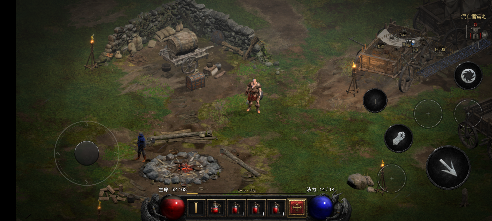
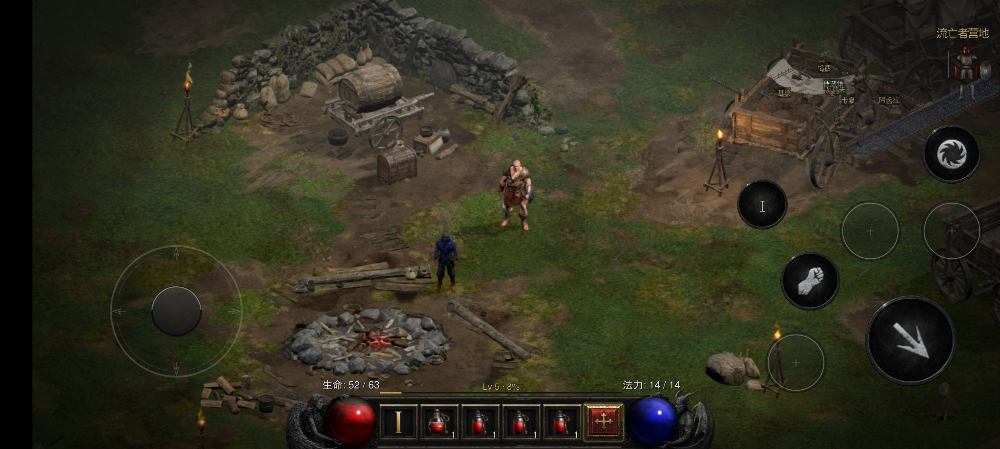

# 安卓分辨率与画质档：适配方案（v2 · 2026-10-18 晚，按真机实测修订）

> **一句话**：**屏幕尺寸是唯一输入**，出图分辨率、3D 比例、UI 画布是**三个派生值**。目标是"任何比例的机器都等比（不拉伸、不加黑边）、任何性能的机器都落在同一成本带、玩家有 3 档可选"。
> 配套的问题记录：[`docs/android-screen-adaptation.zh-CN.md`](android-screen-adaptation.zh-CN.md)；性能实测：[`docs/android-perf-notes.md`](android-perf-notes.md) §0.2 / §7.5 / §7.8。

## v2 改了什么（相对 v1 的 5 处）

1. **"2624×1220 被拉 3.36%"是误判，删掉**。本机 SurfaceView 就是 **2624×1220**（屏幕 2712×1220 左侧 88px 是挖孔黑条：截图像素列 0–87 全黑，SurfaceFlinger `sourceCrop=[0 0 2624 1220]`）。当前默认出图 = S → **1:1，没有拉伸**。方案的价值在"换机不歪"，不在修这台。
2. **三档预算下调**（按今晚实测）：`low 1.8/1.0`、`standard 2.4/1.25`、`high 原生/0.55×出图`。v1 的 `3.0/1.6` 只比现状轻 6%，实测约 24–25 帧，达不到"吃得住"。
3. **high 档改成比例制**（出图=原生、世界=0.55×出图）。v1 写 4.2MP/2.24MP，与表格里的 0.75 自相矛盾，在本机会做出比现状还慢的"高清档"。
4. **补上 0.70 硬下限这条现实约束**：只降 3D 的路线在本机**封顶 24 帧**（出图 3.20MP × 0.70² = 1.57MP 世界），要 30 帧必须同时降出图。
5. **§3① 不再改 `nativeConfigure` 签名**：`nativeSurface` 已经在 `nativeStart` 之前把宽高写进 `window_state`，直接读即可。

---

## 0. 硬约束（不许破坏）

0. **不许写死分辨率（本方案的根）**：运行时决定分辨率的路径**只能**由"屏幕尺寸 × 预算"算出。
   - 三个档位只写**预算（MP）**，不写分辨率；
   - 老档名（`2624-075` 等）**已删除**（v2.1）：`quality.txt` 写旧名会打红日志并回落到界面档位；
   - 代码里除调试用途（`flag-gameres-*`、`flag-scale-*`）外，不得出现 `2624×1220` 这类字面量；
   - 屏幕尺寸在 `nativeStart` 之前就已经到位（`nativeSurface(w,h)` → `window_state`），正常路径永远拿真实 Surface。

1. **iOS 逐字不变**：改动只落在 `dm/android/**` 与 `dm/host/hle_oe.c` 的 Android 分支；`dm/android/diagnostics.c` 是安卓专属文件。
2. **已完成功能不变**：`quality.txt` < `flag-*` < `env.txt` 的优先级、`DM_GAME_RES` / `DM_3D_SCALE` 的单值覆盖语义**全部保留**；老档名不再识别（见 §3②）。
3. **出图分辨率只能在启动时定**（窗口贴图启动时一次建好）；**3D 比例可以运行中改**。
4. **比例永远等于 SurfaceView 的比例**：宽高由同一个 `k` 推出，取偶误差 ≤1px；不允许拉伸，也不允许为某台机器加黑边。
5. 推覆盖层到设备后必须 `chmod -R 777`，否则 App 进不去目录、游戏 UI 初始化直接挂（见 [`docs/android-upstream-sync.zh-CN.md`](android-upstream-sync.zh-CN.md) §5-3）。

## 1. 现状（实测 + 代码位置）

| 项 | 现在 | 位置 |
|---|---|---|
| 测试设备 | 22081212C，屏 **2712×1220**，其中 **SurfaceView = 2624×1220**（左侧 88px 挖孔黑条） | `adb shell wm size`、截图列 0–87 全黑、SurfaceFlinger `sourceCrop` |
| 出图分辨率 | **写死 2624×1220**（= Surface，1:1，无拉伸） | `dm/android/diagnostics.c:250-261` |
| 呈现 | 出图 `vkCmdBlitImage` 拉满 Surface（同尺寸时 1:1） | `dm/gfx/nvn/nvn_vk.c` `mtl_present`（约 3443 行） |
| 3D 比例 | 安卓缺省 **0.75**（iOS 同款），动态降档 0.72 → 0.70，**硬下限 0.70** | `dm/host/hle_oe.c:389-393` |
| 游戏 UI 画布 | 宽度硬上限 **4560 单位 = 19:9**，高度 2160 单位 | `docs/android-perf-notes.md:280` |
| 画质档 | 6 个"出图×比例"组合（2624-075 / 2168-075 / 1080-080 / 2624-085 / 2624-100 / 1600-100） | `dm/android/app_jni.c:410-432` |
| 窗口尺寸 | **已经拿得到**：`nativeSurface()` 存进 `window_state` | `dm/android/app_jni.c:457-470`、`services_platform.h:38` |
| **写死清单**（本方案要清掉的） | `diagnostics.c:260` 默认 `2624×1220`；`app_jni.c:418-422` 档位表里的 6 个分辨率字面量 | 见 §3 ①② |
| 可保留的显式覆盖 | `flag-gameres-*` / `flag-scale-*`（调试开关，不是默认） | `app_jni.c:379-400` |

**今晚真机实测（营地、同步模式、同一场景，2026-10-18）**：

| 配置 | 出图 MP | 世界 MP | GPU | 帧率 | 备注 |
|---|---|---|---|---|---|
| 2624-075（默认） | 3.20 | 1.80 | ~37 ms | 20.5–21.9 | X2 1.286GHz、热机 |
| 2624-070 | 3.20 | 1.57 | 34 ms | 24.1 | X2 1.766GHz |
| 1920×1080×0.8 | 2.07 | 1.33 | 30 ms | 26.4 | 比例错（16:9→19.35:9，横拉 21%） |
| 1920×864×0.8 | 1.66 | 1.06 | 26 ms | 29.6 | X2 1.286GHz；体感最好，但比例错 3.3% |

拟合（本机、本场景）：`GPU_ms ≈ 0.6×出图MP + 14×世界MP + 10`，游戏线程 CPU ≈30ms（1.766GHz）。
**结论：世界像素最贵；但 3D 比例有 0.70 硬下限，出图 3.20MP 时世界最低只能到 1.57MP → 只降 3D 封顶 ~24 帧。**

## 2. 设计

### 2.1 三个派生值（唯一输入 = Surface）

```
S = SurfaceView 像素（nativeSurface 传入；本机 2624×1220）
O = 出图预算（MP）            W = 世界预算（MP）

k      = min(1, sqrt(O / (S.w × S.h)))
out.h  = 偶数(round(S.h × k))
out.w  = 偶数(round(out.h × S.w / S.h))      // 宽由高推：比例严格不变

scale  = clamp( sqrt(W / (out.w × out.h)), 0.70, 1.0 )
world.h = 偶数(round(out.h × scale))
world.w = 偶数(round(world.h × out.w / out.h))   // 世界同样等比
```

- 预算单位是**面积（MP）**，`scale` 是**线性**比例，两者差一个平方；
- 世界预算被 0.70 下限抬高时（显式 `flag-gameres-*` + 低档），**截断并打黄字**，不许 die；
- UI 画布 = `out`（不再做 19:9 裁剪，见 §3④）。

### 2.2 三档（玩家可见）+ 两档（调试，不进 UI）

> **注（2026-10-20 更正）**：本表是 2026-10-18 的设计口径（按 MP 预算反算宽高）。现行实作已改成按
> **纵向像素**定义档位（800p / 1080p / 原生），世界预算是绝对 MP（0.85 / 1.10 / 1.75）。本机实测与
> 现行数值见文末**附十九**；本节、§2.3 与 §3.5 里的数字保留作历史记录，不要再当现行口径引用。

| 档名（`quality.txt`，ASCII） | 界面叫 | 出图预算 | 世界预算 | 本机实际（S=2624×1220） | UI 放大 | 世界屏上放大 | 预计 GPU | 预计帧率 |
|---|---|---|---|---|---|---|---|---|
| **`low`** | 省电 | 1.8 MP | 1.00 MP | 出图 1966×914，世界 1466×682（scale 0.745） | 1.34× | 1.79× | 25 ms | **~30** |
| **`standard`（默认）** | 标准 | 2.4 MP | 1.25 MP | 出图 2270×1056，世界 1638×762（scale 0.721） | 1.16× | 1.60× | 29 ms | **~27** |
| **`high`** | 高清 | 原生（= S） | **0.55 × 出图** | 出图 2624×1220，世界 1944×904（scale 0.742） | 1.00× | 1.35× | 36.5 ms | **~21–22** |
| `switch`（调试） | — | — | — | 1600×900 / 1.0 | — | — | — | — |
| `native`（调试） | — | — | — | S / 1.0 | — | — | — | — |

> `high` ≈ **今天的默认观感**（世界 1.76 vs 1.80MP）；`standard` 比它轻 ~30%，`low` 再轻 ~30%。
> 档名 ASCII 是为了 `quality.txt` 好写、日志好 grep；界面文案走 `dm/i18n/ui_text.tsv`。
>
> **界面上（2026-10-18 定）**：分辨率档放在「自定义」页，Android 专属的一行三选一（省电 / 标准 / 高清），**不单开「图形」页签**。
> 原因：页签条只有 5 个槽，第 5 个（原「控制」）打开的是 KeyBindingMenu（另一种面板类，没有可复用的选项表；「应用」高亮还依赖该面板的每帧更新函数地址），换面板需要真机验证，暂不做。


### 2.3 跨屏幕的落点（预算制的意义：成本带收窄）

| Surface（示例） | `low` | `standard` | `high` |
|---|---|---|---|
| **2624×1220（本机）** | 1966×914 / 1466×682 | 2270×1056 / 1638×762 | 2624×1220 / 1944×904 |
| 2400×1080（20:9） | 2000×900 / 1488×670 | 2306×1038 / 1666×750 | 2400×1080 / 1778×800 |
| 1920×1080（16:9） | 1788×1006 / 1332×750 | 1920×1080（原生）/ 1490×838 | 1920×1080 / 1422×800 |
| 3200×1440（20:9） | 2000×900 / 1488×670 | 2306×1038 / 1666×750 | 3200×1440 / 2372×1068 |
| 2560×1600（平板） | 1696×1060 / 1264×790 | 1958×1224 / 1414×884 | 2560×1600 / 1898×1186 |
| 2208×1840（折叠） | 1468×1224 / 1094×912 | 1696×1414 / 1224×1020 | 2208×1840 / 1636×1364 |

小屏（1080p 及以下）standard 直接原生出图——不会被"放大出图"白白多画像素。

## 3. 改动清单（按顺序，每步可独立验收）

### ① `dm/android/diagnostics.c` —— 出图跟屏幕（收益最大）

`front_game_res()` 现在直接 `return 2624×1220`。改成：

```c
uint64_t front_game_res(int docked) {
    const char *e = getenv("DM_GAME_RES");
    if (e) { /* 原样保留：显式覆盖最优先 */ }
    (void)docked;
    dm_android_window_state ws; dm_android_platform_get_window(&ws);
    unsigned W = ws.width, H = ws.height;
    if (W < 640 || H < 360) {                       /* 理论上不可达 */
        static int once; if (!once++) LOG("【红】窗口尺寸未就绪，出图回落 1280x720");
        return ((uint64_t)720 << 32) | 1280;
    }
    double budget = dm_android_quality_out_budget();  /* 见 ②；缺省 2.4e6 */
    double k = 1.0;
    if ((double)W * H > budget) k = sqrt(budget / ((double)W * H));
    unsigned h = ((unsigned)(H * k)) & ~1u;
    unsigned w = ((unsigned)(h * (double)W / H + 0.5)) & ~1u;
    LOG("出图：屏幕 %ux%u → %ux%u（预算 %.1f MP，比例不变）", W, H, w, h, budget / 1e6);
    return ((uint64_t)h << 32) | w;
}
```

**不要再给 `nativeConfigure` 加参数**：`GameActivity.surfaceChanged()` → `nativeSurface()` 在 `nativeStart()` 之前执行，`front_game_res()` 被问到时 `window_state` 已有值（`GameActivity.java:146→151`）。少改一处 JNI，iOS 风险为零。

### ② `dm/android/app_jni.c` —— 档位表换成"预算"，老档名删除

- `tiers[]` 由 `{name, gamres, scale}` 改成 `{name, out_budget_px, world_budget_px}`，`high` 的 `world_budget_px = 0` 表示"0.55 × 出图"（运行时算）；
- 三档：`low`(1.8e6 / 1.0e6)、`standard`(2.4e6 / 1.25e6)、`high`(0 / 0.55)；
- 老档名（`2624-075` / `1080-080` 等）**删除**：不认识的档名打红日志、回落到界面档位（自定义页 q_res）；
- 调试档保留：`switch` / `1600-100` → 1600×900 + 1.0；`2624-100` / `native` → 原生出图 + 3D 1.0；
- 导出两个小接口（实现放 `diagnostics.c`）：`dm_android_quality_out_budget()` / `dm_android_quality_world_budget()`，**必须返回最终出图**（含 `DM_GAME_RES` 覆盖后的像素）；
- 日志：`ANDROID_QUALITY tier=high → DM_QUALITY_TIER=2（预算档…）`；未知档名 `【红】ANDROID_QUALITY 未知档名…`。

### ③ `dm/host/hle_oe.c` —— 3D 比例按世界预算反算

把安卓缺省 `float base = 0.75f;` 改成：

```c
float base = 0.75f;
#if defined(__ANDROID__)
{ unsigned out = dm_android_quality_out_px();          /* 最终出图像素（见 ①②） */
  double wb = dm_android_quality_world_budget();        /* high 档 = 0.55 × out */
  if (out && wb > 0.0) {
    double s = sqrt(wb / (double)out);
    if (s < 0.70) { static int once; if (!once++) LOG("【黄】世界预算需 scale=%.3f < 0.70，按 0.70 截断", s); s = 0.70; }
    base = (float)(s > 1.0 ? 1.0 : s);
  } }
#endif
const char *e = getenv("DM_3D_SCALE"); if (e) { /* 现有校验与覆盖逻辑，别动 */ }
```

动态降档（0.72 / 0.70）与现有下限逻辑保持不变，作用在 `base` 之上。
**注意**：`DM_3D_SCALE` 的显式值仍走原来的 `die` 校验（0.70..1.0）；**派生值**必须自己 clamp，不许把预算算出来的 0.6x 交给那句 die。

### ④ 画布矩形（贴边元素）—— 本版**降级为可选**，不阻塞前三条

- 本机 Surface 是 19.35:9，按 19:9 裁剪只会把贴右元素往里挪 ~49px，收益不抵风险；
- 若将来上 21:9 / 折叠，再做 `dm_tc_set_canvas_width()`；**iOS 侧不调 = 行为逐字不变**；
- 这一条和渲染比例无关（只影响触摸覆盖层的锚点），别和 §2.1 混。

### ⑤ `dm/gfx/nvn/nvn_vk.c` —— blit 等比（安全网，可后做）

`mtl_present` 现在按 `swap_extent` 拉满。正常情况 `out` 已等于 Surface 比例（1:1 或整数倍），不触发；只有 `DM_GAME_RES` 手写到异比例时才需要：
按 `out` 比例算居中 dst 矩形（等比缩放；比例不符时留边，不许拉伸）。

### ⑥ 日志一行

启动时打：`S=2624x1220 canvas=2624x1220 out=2270x1056 world=1638x762 scale=0.721 tier=standard`。

### ⑦（可选，不阻塞）自校准

首启统计动态降档控制器停在 0 / 1 / 2 级的比例（`hle_oe.c` 的 `scale3d_ctl` 已有），600 帧写一次 `diagnostics/autotier.txt`（建议档 + 依据），下次启动在 `quality.txt` 未显式指定时采用。
判定：>50% 时间在 1–2 级 → 下次降一档；全程 0 级且掉帧 <2% → 下次升一档；其余保持。热机（thermal ≥2）一律不升。
**不要**用 GPU/CPU 型号名单做主依据（跨厂商数字不可比、新机追不上）。

## 3.5 实施状态（2026-10-18 已落地）

| 步骤 | 状态 |
|---|---|
| ① `front_game_res` 按档位预算派生出图 | ✅ 已实现（`dm/android/diagnostics.c`） |
| ② 档位表改预算档、老档名删除、加 `DM_QUALITY_TIER` | ✅ 已实现（`dm/android/app_jni.c`） |
| ③ `hle_oe.c` 3D 比例按世界预算反算 + 0.70 截断 | ✅ 已实现 |
| ⑧（新增）自定义页「分辨率」三选一（Android） | ✅ 已实现（`dm/host/dm_custom.c`、`touch_layout.py`、`ui_text.tsv`、`gen_overlay.sh`） |
| ④ 画布 19:9 裁剪 | ❌ 不做（要求"比例不改"，画布 = 出图） |
| ⑤ blit 等比安全网 | ⬜ 未做（派生出的 out 已等于 Surface 比例，正常路径不触发） |
| ⑥ 启动日志 | ✅ 已实现（`分辨率档读盘为…` / `出图：按分辨率档算 → …` / `ANDROID_3D_SCALE_CONFIG base=…`） |
| ⑦ 自校准 | ⬜ 未做 |

真机实测（本机 2624×1220，**旧档位定义**，现行数值见附十九）：`low` → 1966×914/0.746；`standard` → 2270×1056/0.722；`high` → 2624×1220/0.742；`native` → 2624×1220/1.000。

## 4. 验收

**离线（每步都跑）**

```bash
cd dm/android/build && ninja          # 原生库
cd - && dm/android/tools/build_apk.sh # 打包
bash dm/android/tools/sync_surface_audit.sh   # 冲突面只许降/持平（当前 43）
python3 dm/i18n/scan_literals.py
python3 dm/ios/tests/test_touch_layout_options.py
```

**真机**（手机当前走无线 adb：`192.168.31.46:5555`，也可插 USB）

```bash
dm/android/tools/deploy_apk.sh
# 覆盖层没有改动就不用重推；若重推，记得 chmod（见 §0-5）
```

1. **三档各跑一次**：`diagnostics/quality.txt` 写 `low` / `standard` / `high`（注意 `chmod 664`，否则 App 读不到内容），**重启**，核对日志那行尺寸；
2. **比例扫描**（同一台机，`wm size`，**每改一次必须重启 app**——出图是启动时定死的）：

```bash
adb shell wm size 1220x2169   # 16:9
adb shell wm size 1220x2440   # 18:9
adb shell wm size 1220x2643   # 19.5:9
adb shell wm size 1220x2712   # 20:9（原生）
adb shell wm size 1220x2847   # 21:9
adb shell wm size 1220x1464   # ~1.2:1（折叠）
adb shell wm size 1220x1952   # 16:10（平板）
adb shell wm size reset
```

每档看三件事：①有没有黑边/拉伸（出图比例必须等于 Surface 比例）；②底栏格子与药水格是否对齐；③技能弧/地图键是否在屏内。
3. **帧率**（本机营地，冷机起测、热机取末 30 秒）：`standard` 应 ≥27、`low` ≥30；日志里 GPU 工作量应落在 25–29ms；
4. **回归**：语言、建角、背包、选项、自定义页、暂停菜单各点一遍（清单见 `docs/android-ui-parity-lessons.zh-CN.md`）。

## 5. 风险与取舍

| 风险 | 说明 | 处理 |
|---|---|---|
| UI 变软 | 出图低于 Surface 时，UI 被放大：low 1.34× / standard 1.16× | 默认 `standard`；觉得软选 `high`（1.00×） |
| 只降 3D 到不了 30 帧 | scale 硬下限 0.70 × 出图 3.20MP = 世界 1.57MP，实测 24.1 帧 | 低档必须同时降出图；要更快只能开时域超分（§6） |
| 世界预算被下限抬高 | 显式 `flag-gameres-2624` + low → 预算需 0.56 | clamp 到 0.70 + 黄字日志，不 die |
| 手感变化（§④） | 贴边元素改贴画布，21:9/折叠上离边更远 | 本版不做；将来单独验收 |
| 老档名失效 | 玩家/脚本里写的是 `2624-075` 这类 | v2.1 起已删除；写旧名打红日志并回落到界面档位 |
| 平板/折叠没真机 | 只能靠 `wm size` 模拟 | 至少按 16:10 / 折叠比例各过一遍 |

## 6. 明确不做

- 不做时域上采样（FSR / GSR / ASR / TAAU）——下一个台阶，工程量另算（这也是"0.7 也不糊"的行业答案）；
- 不改 iOS 的 0.75 缺省与动态降档逻辑；
- 不动 `quality.txt` < `flag-*` < `env.txt` 的优先级；
- 不在运行中改出图分辨率（做不到，窗口贴图一次性）；
- 不按 CPU/GPU 型号名单定档（见 §3⑦）。

## 附：v2 的档位为什么是这组数

`GPU_ms ≈ 0.6×出图MP + 14×世界MP + 10`（本机营地实测拟合）：

| 档 | 出图 | 世界 | GPU | 帧率 |
|---|---|---|---|---|
| low | 1.8 | 1.00 | 25.1 | ~30 |
| standard | 2.4 | 1.25 | 28.9 | ~27 |
| high | 3.20 | 1.76 | 36.5 | ~21–22 |

对比用户体感过的 `1920×864×0.8`（1.66 / 1.06，实测 29.6）：`low` 与它世界成本相同（1.0 vs 1.06MP），出图多 8%，UI 从 1.41× 清晰到 1.34×——**同样的帧率，画面更好一点，比例也对**。

## 附二：2026-10-19 复测——世界比例在 30fps 档位上的甜点

提交 `3c8c7dd`（主提交上下文双缓冲）之后，帧内死等从 5ms 降到 0.1ms，营地进入 30fps 档
（29.4–30.1，CPU ≈33ms / GPU ≈28ms，**CPU 重新成为约束**）。此时重扫世界比例（出图固定
2270×1056，同一局营地，逐档重启）：

| 世界比例 | 世界分辨率 | fps 中位 | 等 GPU | GPU util |
|---|---|---:|---:|---:|
| 0.722（当前标准档） | 1639×762 | 29.48 | 1.0ms | 82.5% |
| 0.80 | 1816×845 | 29.47 | 1.9ms | 88.6% |
| 0.85 | 1930×898 | 29.33 | 2.0ms | 92.2% |
| **0.90** | **2043×950** | **29.93** | 1.5ms | 76.8% |
| 1.00（原生） | 2270×1056 | 28.56 | 5.4ms | 97.4% |

**结论：0.722 → 0.90 帧率持平甚至略优，只有到 1.0 才掉 3%。**

这推翻了 §附 里“13×世界MP”那条拟合的前提——它是按 GPU 受限时代的数据拟合的；一旦
CPU 成为约束，世界的边际成本就被 CPU 的余量吸收掉了。也就是说**档位预算在 CPU 受限的
时候是保守的**：同一帧率下世界像素还能多给 81%。

注意（必须写清楚）：
- 只测了营地，未测战斗/大量特效场景；战斗更吃 GPU，0.90 在那里的行为未验证；
- 因此本轮**没有改缺省档位**，只记录甜点。要用就 `DM_3D_SCALE=0.88~0.90`；
- 若要把它做成缺省，应该按“等 GPU 时间接近 0 时逐步上调、掉帧时回退”的闭环（DRS 已有
  下调档位 0.70/0.65/0.60，缺上调档位），而不是硬编码一个更高的预算。

## 附三：40fps 攻坚记录——UI 精灵 draw 合批（未完成，已回退）

目标：标准档 CPU ≈33ms、GPU ≈28ms，下一档 40fps 需要 25ms，缺口 **8ms**。

落点测算：每帧 1,977 笔 draw 里，**UI 有 814 笔只画 3,254 个顶点**（平均 4 顶点/笔）。
实测相邻 UI draw 的共享程度：同顶点着色器 812/814、同像素着色器 779/814、同 VS uniform
811/814、同 PS uniform 773/814，**唯一不同的是各自的小顶点缓冲**。把连续的 4 顶点
triangle strip 用退化三角形拼成一次 `vkCmdDraw`，813 次 per-draw（实测每笔 ~9µs）就能压成
1 次 ≈ 7ms——正好是缺口。

已完成的验证（重要，下一次从这里开始）：

| 阶段 | 内容 | 结果 |
|---|---|---|
| 只改绑顶点缓冲、逐笔仍立即画（`DM_UI_MERGE=2`） | 顶点拷贝 + firstVertex 偏移 + 自有缓冲 | **正常**：29.99/29.96 fps，无 fatal，画面正确 |
| 真合并成一次 draw（`DM_UI_MERGE=1`） | 延迟到通道结束再发一次大 draw | **崩溃**：guest 代码 SIGSEGV（`guest=1`, address=0x128） |

结论：**顶点重定向/偏移路径已验证正确**；问题出在"延迟合并"的那一次大 draw。已排除：
顶点缓冲复用跨帧未同步、`buffer_make()` 在录制中调用、`S.in_pass` 外发 draw（都补过，仍崩）。
第四轮又排除了 **flush 时序**：原先 flush 放在 pass_end 里，那时新一笔的描述符已经绑上、管线还是
上一笔的，pipeline/descriptor 不匹配属于未定义行为；改成"draw 入口（bind_shader 之前）+ 帧提交前"
之后**仍然崩溃**——说明根因不在 flush 时序，也不在绑定状态，而在"一次画完 4,884 个顶点"这个
动作本身或它之前的顶点数据布局。

第五轮进一步排除**缩放与开批绑定**：
- 用 `DM_UI_MERGE_N=2`（只合并两笔）→ **仍然崩**，所以不是顶点数过大；
- 发现并修掉一个真 bug：开批那一笔提前 return 了，导致 `g_umb.vb` 从未被绑上 → 修后仍崩；
- 崩溃是 guest 代码空指针（`address=0x128`，无 die 消息），且发生在合并刚启用的那一帧，
  更像**驱动侧出错后的连锁反应**（无效顶点绑定 → GPU 故障恢复 → 游戏拿到坏返回值），
  而不是我们的控制流问题。

结论：这条优化需要能看驱动侧报错的工具（Vulkan validation layer 或驱动日志），
在本机不可用（validation layer 未安装）。**在拿到那个工具之前不再尝试。**

下一步该怀疑的方向（尚未验证）：
1. 延迟期间命令缓冲被 `sub_chunk_flush` 换掉（虽然它在 `S.in_pass` 时直接返回，但 `pass_end`
   到下一个 `vkCmdBeginRenderPass` 之间的窗口需要单独确认）；
2. 合并后一笔 draw 的顶点数（~4,884）与驱动对单次 draw 的隐含上限；
3. 退化三角形在该驱动上的行为。

建议用最小夹具（全屏 RT + 两笔 4 顶点 strip）先离线验证一次合并 draw，再上真机。

## 附四：ASan 复现——合批在 ASan 下不崩，也不报错

用 `-DDM_ASAN=ON` + `DM_PACK_ASAN=1`（运行时 libclang_rt.asan-aarch64-android.so 打进 APK）
构建，插桩确认生效（.so 内 41 个 `__asan` 符号、build.ninja 带 `-fsanitize=address`）。

在 ASan 版上打开同一套 UI 合批（`DM_UI_MERGE=1 DM_UI_MERGE_N=2`）：

| 构建 | 结果 |
|---|---|
| 发行版 | 稳定崩溃（guest SIGSEGV，address=0x128，无 die 消息） |
| **ASan 版** | **不崩溃、画面正常、30 fps**；**ASan 没有任何报告** |

结论：
1. 崩溃**对内存布局敏感**（ASan 的 redzone 改变布局后不再触发）——典型的内存破坏特征；
2. 但 ASan **没有报出越界**，说明出错的位置**不在 ASan 能跟踪的内存里**——最可能是
   Vulkan 映射的缓冲（我们的合批顶点缓冲是 `vkMapMemory` 的，ASan 看不见）或驱动内部；
3. 因此 ASan 这条路对本 bug 无效，需要 **HWASan**（对非 malloc 内存更敏感，需 arm64 +
   `-fsanitize=hwaddress`）或对合批缓冲加**显式哨兵校验**（写入后在末尾放 canary，flush 前校验）。

下一步建议：给合批缓冲加 canary（成本极低、能直接证明是不是我们写越界），或在合批缓冲前后
各留一页 PROT_NONE 的守卫页（mmap 自管内存，不经过 Vulkan）。

## 附五：哨兵校验证明合批缓冲没有被写坏

在合批缓冲的写入位置之后放 64 字节 0xA5 哨兵，每次 append 与 flush 前校验；同时校验
`used` 不越界、`same` 分支的 `used>=stride`（防止从缓冲起点之前读）。

结果：**哨兵从未报警**（崩溃前后都完整），`die()` 一次没触发，崩溃仍是 guest SIGSEGV
（address=0x128）。

至此可以确定：**我们的合批顶点缓冲没有被越界写**。结合前面三条——
- 驱动侧无任何 ERROR（`VK_EXT_debug_utils` 已接通）；
- ASan 下不崩、无报告；
- 哨兵完好；

剩下的解释只剩：**这次合并 draw 触发了驱动侧的问题（挂起/复位），游戏随后拿到坏返回值而崩**。
也就是说问题不在"我们写的数据"，而在"我们发出的那次 draw 本身的形态"（4,884 顶点、退化三角形、
单缓冲多段 strip）。

下一步应该换**形态**而不是继续查内存。先纠正一个想法：**instancing 不可行**——游戏 UI shader
每个精灵的位置都在顶点属性里，不存在 per-instance 数据通路；要实例化就得改 shader，而 shader 是
翻译好的原版，不动。

所以只剩一种不同形态：**索引化的 TRIANGLE_LIST**——
- 顶点仍是 4 个/精灵，拼进同一个缓冲（没有退化三角形）；
- 另建一条索引缓冲：每精灵 6 个索引（0,1,2, 0,2,3），索引可直接复用；
- 拓扑从 TRIANGLE_STRIP 改成 TRIANGLE_LIST：PSO 键含拓扑，会自动生成并缓存一条新管线；
- 一次 `vkCmdDrawIndexed(6N)` 画完。

这条和退化 strip 的区别是**几何形态完全不同**（无退化三角形、有独立索引缓冲），如果此前的崩溃
确实来自"退化三角形在该驱动上的行为"，这条就能绕过；如果仍然崩，则说明问题出在"一次 draw 覆盖
大量互不相关的精灵"这个更本质的点上，那就要回到分批（但 N=2 已崩，说明不是规模）。

## 附六：TRIANGLE_LIST（无退化三角形）同样崩溃——形态不是根因

把 4 顶点 strip 展开成 6 顶点（0,1,2 / 0,2,3）、拓扑换成 TRIANGLE_LIST 建管线，**完全避开退化
三角形**，`DM_UI_MERGE_N=2` 下仍然崩溃（guest SIGSEGV，address=0x128）。

至此六种形态/假设全部排除：
1. 顶点缓冲跨帧未同步；2. `buffer_make()` 在录制中调用；3. `S.in_pass` 外发 draw；
4. flush 时序（pipeline/descriptor 不匹配）；5. 顶点数过大（N=2 也崩）；6. 退化三角形形态。

结合：驱动侧零 ERROR、ASan 不崩且零报告、**哨兵证明缓冲未被写坏**——

**剩下的唯一解释：问题出在"跳过那些 per-sprite draw"本身，而不是合并后的那次 draw。**

每次跳过都跳掉了该笔的 `bind_shader`（描述符/纹理布局转换/`collect_image_uses` 登记）、
pipeline 绑定和 `vkCmdDraw`。这些被跳过的副作用里有一项是后续流程（或驱动）依赖的，
目前的分批条件（同 vs/ps/sig）不足以保证它们可省。

下一步该做的是**逐项验证"跳过什么会崩"**：例如保留 `bind_shader` 只跳过 `vkCmdDraw`，
再逐步加回，直到定位到具体是哪一步的副作用不能省。

## 附七（结论已作废，见附八）：曾以为 shader 用顶点序号索引每精灵数据

第七轮做了**纯差分实验**：每笔精灵仍走完整路径（`bind_shader`、管线、顶点绑定、写回），
**只抑制它自己的 `vkCmdDraw`**，flush 时再合并画一次 TRIANGLE_LIST。`N=2` 仍然崩。

而此前已验证：**每笔单独从我们自己的缓冲画（改 `firstVertex`）完全正常**。

两者只差一件事：**一次 draw 里的 `gl_VertexIndex` 会跨过多个精灵**（0…6N-1），
而单独画时永远在 0…3。

这就解释了所有现象：
- 游戏 UI 是精灵批处理器，shader 极可能用顶点序号索引"每精灵数据"（`index/4` 选精灵）；
- 合并后序号越出该数据范围 → **GPU 侧越界读**（不是 CPU 内存，所以 ASan 看不见、哨兵不会响）；
- 驱动侧没有 Vulkan API 错误（因为 API 用法本身合法）；
- `N=2`（序号到 11）就已经致命。

**所以 UI 合批在"不改 shader"的前提下从根本上不可行**——7ms 这条路是死的，不必再试。

如果将来真要拿这 7ms，只有两条路：
1. 改 UI shader（把每精灵数据改成 per-instance 或把变换写进顶点），但要改原版 shader；
2. 不合并 draw，改为降低每笔的绑定成本（bind 6.7ms 里缓冲侧 89%，见附一）。

## 附八：反汇编否掉了附七的解释

`spirv-dis` 反汇编 UI 顶点着色器（`f88d27f131d71049_b.spv`）：

- **`VertexIndex` 出现 0 次**——shader 完全不读顶点序号；
- 它只读两个普通顶点属性（`OpVariable ... Input %v4float` ×2），是标准顶点着色器。

**所以附七的"顶点序号越界索引每精灵数据"解释不成立，该结论作废。**

现在的事实是：
- 每笔单独从自有缓冲画（改 `firstVertex`）**正常**——顶点数据、stride、属性都对；
- 一次 draw 画多笔（无论退化 strip 还是 TRIANGLE_LIST）**必崩**；
- 驱动无 API 错误、ASan 无报告、缓冲哨兵完好、shader 不读序号。

剩下的可能性已经不多，且都指向"驱动/固件对某种 draw 形态的特异性"，而不是我们能从 API 层看到的
东西。要再往前，需要 GPU 侧的调试手段（RenderDoc 级抓帧或 Qualcomm 的图形调试工具），
本机不具备。

**结论：UI 合批在现有工具下无法继续推进，7ms 这条路暂时封存。**

## 附九：按 RT 并行 replay 的实施方案（尚未开工）

### 为什么只剩这条
实测：8 个核里只有 1 条线程 100% 满载（其余 15–25%），热点是单线程串行。减少该线程的工作
（绑定计划、读出备忘、命令缓存、描述符缓存）已全部试过且全部中性——成本在"每个绑定必须重新
解析"，缓存救不了。所以只剩两条：把工作变少（已穷尽）或**把它拆成两半**。

### 可并行的依据
每帧的通道按 RT 可以分成两组，互不依赖：
- 世界组：1639×762，16 pass，839 draw，约 12.9ms GPU；
- UI 组：2270×1056，27 pass，814 draw。

两组之间只有**跨通道拷贝**和**全屏 effect 链**需要保序。实测每帧有 12 次 T2T 拷贝，
其中一部分是跨组依赖。

### 实施步骤（建议顺序）
1. **先建"分流不并行"**：在录制层按 RT key 把命令分到两个桶，仍然按原顺序提交。这一步只验证
   分流判据正确（哪些命令属于哪组、跨组依赖在哪），画面必须完全不变。
   （2026-10-19 分段切分点已实测稳定，见附十。）
2. **加第二套提交上下文 + 第二录制线程**：两组各自录制、各自 `vkQueueSubmit`。用 fence 保证
   组内顺序；跨组依赖点插入双向信号量。
3. **只在"无跨组依赖的帧段"启用并行**：先用只读探针统计每帧跨组依赖次数，为 0 的帧段才并行，
   有依赖就退回顺序。这样正确性有兜底，收益按比例拿。
4. **A/B 开关**：`DM_RT_PARALLEL=1`，默认关；用 `tools/pf/sf_fps.py` 测，必须同时看掉帧率。

### 风险与已知坑
- 双缓冲那次已经踩过："只给单个上下文初始化"的资源（命令池、描述符缓存）必须按上下文创建；
- 命令顺序改变会破坏 `precise_sync` 的屏障推断，需要按组分桶后重新推导；
- 游戏 12 次/帧的 T2T 拷贝里如果有跨组，必须显式同步，否则会出现"半帧旧内容"的闪烁。

## 附十：按 RT 分段表实测（2026-10-19，第一步完成）

目标：确认「按 RT 并行 replay」的切分点每帧稳定；只加统计，画面与 fps 不变。
代码：`3aab27e`（`dm/gfx/nvn/nvn_vk.c`，默认关的诊断）。

### 分段表（营地稳态，逐帧字节级相同）

采样帧 1500–1507 / 2404–2407，恒 5 段：

| 段 | 组别 | 起始 op | ops | draws |
|---|---|---:|---:|---:|
| [0] | g1 全屏(UI) | 1 | 19 | 0 |
| [1] | g0 世界(3D) | 20 | 22 | 0 |
| [2] | g1 全屏 | 42 | 13,046 | 812 |
| [3] | g0 世界 | 13,088 | 23,226 / 23,166 | 1,166 / 1,163 |
| [4] | g1 全屏 | 36,254 | 73 | 2 |

合计 36,326–36,386 ops/帧；窗口组别统计 world 23,166–23,266 / 1,163–1,167、ui 13,138 / 814、
**switches=4**——与 `edb70bd` 和 `rt-parallel-draft.md` 落点一的「4 次切换 → 5 段」一致。

两个对下一步有用的细节：
- **大 UI 段在大世界段之前**，顺序是「前导 → g0 → UI 13k → 世界 23k → 尾」，不是交错；
- 角色选择界面是另一套结构（`[2]g1+4072/250 [3]g0+16900/823`），所以「每帧稳定」只在同一场景内成立，
  换场景要重新采样。

### 负结果（复测到并已修正）：逐条分类要 -0.9fps / 3%

`edb70bd` 的组别统计在**每条指令**上解引用 `G.state.rt.color[0]->d.width/height`。
在**完全相同 draw 数（114,780）**下快速交替 A/B（60 帧窗口，n=48/27）：

| 分类 | fps 均值 | fps 中位 |
|---|---:|---:|
| 关 | 28.34 | 28.73 |
| 开 | 27.40 | 27.84 |

→ **约 -0.9fps（-3%）**。`G.state.rt` 只在 `OP_SET_RT` 改变，所以组别应在那一处重算一次并缓存
（`g_rtgrp_cur`），逐条只做计数。改成缓存版后重测（同 draw 数 118,620）：

| 分类 | fps 中位 |
|---|---:|
| 关（n=16） | 26.43 |
| 开（n=22） | 26.54 |

→ 差异进入噪声，**缓存版开销 ≈ 0**。这一步同时修掉了 `7551f28` 摘掉的那 3%。

### 开关与默认

`diagnostics/rtseg.txt`：**0 关（默认，零成本）/ 1 只组别统计 / 2 组别+分段表**，运行时切换。
默认关保证默认路径的帧率与画面不变；开启也几乎不花时间（组别已缓存）。

### 跨组依赖探针（附十续，`RENDER_RT_COPY`）

把每笔 T2T 拷贝的源/目标按自身尺寸归类（>2000×900 = 全屏组），统计同组/跨组：

```
RENDER_RT_COPY frame=2282 same_group=2 cross_group=0
```

**营地稳定帧：T2T 拷贝 2 笔/帧，全部同组，跨组 0 笔。**
所以「12 次 T2T 里一部分跨组」这个担心在营地不成立（12 次那批是启动/切场景时统计的）。
结论：下一步的跨组同步点不可能来自 T2T 拷贝，要往「draw 采样了另一组写过的贴图」方向查
（全屏 effect 链/合成），这需要给贴图打「最后被哪一组写」的标记，是落点二的前置。

### 跨组读依赖探针（附十续 2，`RENDER_RT_DEP`）

登记「贴图本帧最后被哪一组写」（pass 附件 + copy 目标处），采样绑定时比对当前组：

```
RENDER_RT_DEP sampled_same=1519 sampled_cross=2
```

营地稳定帧：**每帧只有 2 笔跨组采样读**（同组 1,519 笔），两张贴图：
- 一张 1639×763 的**世界分辨率**贴图——正是每帧 `COPY_T2T src=2598 dst=2596` 的 dst；
- 一张全屏贴图。

**三组数据合起来，落点二的依赖复杂度很低：**

| 量 | 营地/帧 |
|---|---:|
| 组间切换 | 4 |
| 段数 | 5 |
| 跨组 T2T 拷贝 | **0** |
| 跨组采样读 | **2** |

也就是说两组之间只要在这 2 处插同步即可，其余全是组内顺序。

开关扩到 `rtseg.txt` **0/1/2/3**（3 = 加依赖探针）。探针自身开销约 −0.3fps
（level2 中位 26.95 / n=55 vs level3 26.61 / n=14），在噪声量级。

### 顺带确认：30fps 基线当前不可复现

本轮营地实测 26–29fps，而附二是 30.0：`gpu_wait` 6–24ms（附二 1.0ms）、GPU util 79%、
cpu7 1.286GHz，而 draws 与附二一致（UI 814、世界 1163–1167）——**场景相同、等 GPU 明显变长**。
角色选择界面仍有 30fps。所以「30→40」要先对齐/说明热态基线，否则会把整机变慢算进优化账里；
建议下一步同时记录 `gpu_wait` 与 `SYS_FREQ` 作为基线条件。

## 附十一：30 → 36.6fps 的真解——翻译队列 + 25ms 出图节拍（2026-10-19）

**结论：`0cf4904`。营地标准档 30 → 36.6fps（+22%），掉帧 0，画质不变。**

### 真因：同步模式下 replay 跑在游戏线程里

`dm/android/app_jni.c` 原本把 `DM_NVN_SYNC=1` 写死为默认（翻译队列关闭）。此时
`nvnQueueSubmitCommands` 每帧 **25.2ms** 全花在 `x_push` 内部——不是入队慢，而是
**同步模式下这 25.2ms 是它自己在算 replay**（`g_x_sync` 分支当场执行 `x_run`，不是等待）。
开启队列后同一项降到 **0.020ms**（1000 倍）——注意那不是"变快了"，是**把这份工作搬到另一根核上**。

**机制（容易说错的地方）**：翻译线程是普通 CPU 线程、由内核调度，不是"异步 I/O"。
总 CPU 用量反而更高（进程 CPU 197% → 223%），但帧时间从"逻辑 + replay 串行相加"变成
两者在两根核上取 max，同时 GPU 不再等喂料（util 84% → 93%）。所以收益是
**跨核流水并行 + 关键路径变短**，不是减少了工作量。若 CPU 已经吃满，这条就不会有收益
（`app_jni.c` 里原本那句"大核吞吐受限无增益"就是针对那种情形，但在本机上不成立：
进程 CPU 才 223%，8 核还有余量）。

但只开队列不够：默认出图节拍是 33.3ms（游戏 interval 2 @ 60Hz），**本来就封顶 30fps**。

### 交替 A/B（同热态，RENDER_PROFILE 60 帧窗口中位）

| 配置 | fps 中位 | GPU util |
|---|---:|---:|
| 队列开 + 25ms 节拍 | **36.11 / 35.90** | 97–100% |
| 队列关 + 25ms 节拍 | 30.50 / 30.12 | 81–84% |

验收（纯默认配置，无任何 env 覆盖）：`sf_fps.py` 36.36 / 36.21 / 35.76 / 36.60 / 36.61，
P50 24.79ms，掉帧 0；`RENDER_PROFILE` 34.9 / 36.35 / 36.35 / 34.89 / 36.44 / 36.28（交叉一致）。

回退：`diagnostics/disable-nvn-queue`（已验证回同步）；`DM_PRESENT_HZ` 覆盖节拍。

**口径说明（36.6 是热态保守值）**：设备凉时同一配置实测中位可达 **38.60fps**
（40 个 60 帧窗口：min 34.32 / max 40.59，帧时间中位 25.91ms）。热态下会掉到 34–36.6。
所以引用成绩时要说明设备状态；跨启动还存在**双稳态**（见附十三），单次测量不可信。

### 踩过的坑：我第 8 轮的错误结论

第一次只开队列、**用默认 33.3ms 节拍**测，得到「30fps，无收益」，于是判断「队列无效」。
这个结论是错的——节拍本身就封顶 30，缺的是第二个变量。**教训：A/B 必须确认被测配置
没有更早的天花板。** 是用户追问「为什么不试试开翻译线程」才发现。

### 顺带纠正三处「死代码」误判

Android 上 `hle_nvn.c` 的 `#ifdef __ANDROID__` 会用 `nvn_platform_present.inc` 整体替换
翻译队列实现，因此 `hle_nvn.c` 的 `#else`（Apple）分支在 Android 上是死代码。本轮先后三次
把改动/探针写进了那里，全部无效：`x_submit`、`DM_PRESENT_HZ` 的数字 interval 覆盖、
`DM_NVN_PROF` 的逐函数报告。**以后改 Android 提交/出图路径，只认 `.inc`。**

另外：`.inc` 里 `周期 = (1e9/DM_PRESENT_HZ) × 游戏 interval`，而 `android_display_intervals`
在有窗口时恒为 1——所以 `DM_PRESENT_HZ=40` 实际是 50ms，不是 25ms。要 25ms 得写 `80`。

## 附十二：这一轮全部负结果（都别再试）

### 按 RT 并行 replay：三种实现全部劣于基线（`experiment/rt-parallel-replay` 分支存档）

| 实现 | fps |
|---|---:|
| 基线（单线程 eager） | 29.3–30.1 |
| 两线程 + 延迟合并提交 | 12.2 |
| **单线程单上下文** + 延迟合并提交（隔离实验） | 12.0 |
| 两线程 eager 两队列 | 14.2–14.8 |

关键隔离实验：单线程版和两线程版一样慢 → **慢的不是两线程共享状态，是「延迟提交」本身**。
基线靠「边录边提交」让 GPU 在 CPU 录下一块时就开始跑；延迟到录完再一次性提交，GPU 在整段
录制期间空转，帧变成「录制 + 执行」串行（33 + 25 ≈ 58ms，实测 78–85ms）。

eager 两队列版进程 CPU 到 159%（两线程确在并行），但 GPU 侧从 25ms 涨到约 45ms。

且最终确认：**优化错了线程**——并行 replay 砍的是 replay（当时 22.9ms），而当时的真正瓶颈
是游戏线程等它（见附十三）。

### 出图节拍四档全试过

| 节拍 | fps |
|---|---:|
| 33.3ms（默认） | 29.7 |
| 28.6ms（`DM_PRESENT_HZ=70`） | 30.4 |
| 25ms（`DM_PRESENT_HZ=80`） | 30.0（**当时未开队列**） |
| 8.33ms（display 模式跟 120Hz） | 25.5–30.1 |

25ms 档在**开队列之后**才变成 36.6fps。单独放开节拍只是让工作量暴露出来。

### 描述符动态偏移（sydeEvans 863ff4a）：量级不够，不做

| 指标 | 我们 | 他们 |
|---|---:|---:|
| 描述符未命中 | **136 次/帧** | 1131 次/帧 |
| desc_alloc + desc_update | **1.27 ms/帧** | 2.63 ms/帧 |

我们命中率 89.9%，重建量是他们的 1/8。上限 1.27ms，且瓶颈在 GPU，省下来不会变成 fps。

### 「关描述符缓存快 15%」是假象

交替 6 轮测出**自相矛盾**的结果（同一配置两次分别 34 与 39.9）。根因是**跨启动双稳态**，
与缓存开关无关。CPU 分项还证明关缓存更差：bind 9.10 → 13.20ms，full 绑定 1887 → 3763 次。

### 让出退避（`e735628`，保留但当前无效）

`hle_thread.c` 的 `SleepThread` 裸 `sched_yield` 是真 bug：主线程每帧让出 **403 / 503 / 1145 / 1771 次**
（sydeEvans 报 273 次）。退避后降到 17–22 次，同步模式下 `gpu_wait` 286ms → 38–85ms。

但**当前配置下 fps/温度/GPU util 全无变化**（ON 33.65/36.67 vs OFF 33.59/36.86，都是 45.7°C）——
主线程空转已不是瓶颈。作为共享层防御性修复保留，开关 `DM_NO_YIELD_BACKOFF=1`。

### 附件 store 跳过（`8d2dd65`，默认关，`diagnostics/enable-att-skip` 开启）

审计（`DM_ATT_AUDIT=1`）修正口径后：store 总量 525 MB/帧，跨帧真正需要 294.9 MB，
本帧内被读 ≈100 MB，**白写 ≈130 MB/帧（约 25%）**。

深度通道 skip 实测：store 465.3 → 253.2 MB/帧（−45%），总流量 930.7 → 718.9 MB（−23%），
**fps 不变**（33.64 vs 33.74）——瓶颈是 GPU 计算量而非带宽。

验证边界：营地 + 营地外静态对拍（角色不动、同进程交替 `attskip.txt`）噪声基线 2.78–3.06%，
跨档 3.35%；**分区热力图同档与跨档形态一致** → 无可检测差异。
但**战斗、特效、多怪、过场未验证**，且 Vulkan 允许 `DONT_CARE` 留任意内容，故默认关。

**这里我犯过一个测量错误并已更正**：第一次对拍报了 71.6% 差异，据此宣称「画质崩坏」。
实际两张截图相隔 22 秒、测试者正在出营地打怪，**差异来自场景变化**。教训：像素对拍必须先跑
噪声基线，且两次截图必须同一游戏状态。

## 附十三：GPU 空洞定因——真正的天花板是 CPU 录制

### 测量方法

引擎已有 `CHUNK_TIME`（每块 GPU 起止时间戳）：`dur` = 块执行，`gap` = 块间空洞。

### 结果（营地，16 块/帧）

| 帧 | dur（GPU 实际工作） | gap | span | fps |
|---|---:|---:|---:|---:|
| 1 | 23.76 ms | 1.68 ms | 25.44 | 39.3 |
| 2 | 23.79 ms | 2.77 ms | 26.57 | 37.7 |
| 3 | 23.95 ms | **4.09 ms** | 28.04 | 35.7 |
| 4 | 24.02 ms | 3.17 ms | 27.20 | 36.6 |

**`dur` 恒定 23.8–24.0ms，帧时间的全部差异来自 `gap`。** GPU 只需 24ms（对应 41fps），
35–37fps 是 CPU 录制慢。

### 阈值效应（关键）

| CPU 合计 | 帧时间 | fps |
|---:|---:|---:|
| 22.91 ms | 25.06 ms | **39.9** |
| 23.21 ms | 27.83 ms | 35.9 |

CPU 多 0.3ms，帧时间涨 2.8ms。**跨过 ~23ms 这条线，收益是跳跃式的（35 → 40）。**

### replay 25.83ms 的完整分解（`DM_PROFILE_DETAIL=1`）

| 项 | ms/帧 |
|---|---:|
| **bind** | **9.21**（full 1887 次/帧 × 3.47µs，loop 4.96） |
| **tail** | **4.58** |
| pool | 2.81 |
| state | 1.78 |
| renderpass | 1.58 |
| pso | 1.17 |
| present | 1.09 |
| lookup | 0.92 |
| vertex | 0.88 |
| desc_update / alloc | 0.80 / 0.50 |
| prep | 0.50 |

### 已排除的因素（都有实测）

- **异步提交**：默认就开着（`async_enabled = !DM_DISABLE_ASYNC_COMMIT`），每块立即入队不等待
- **chunk 深度**：16 / 8 / 48 → 36.8 / 35.6 / 37.5，更小块更差
- **`DM_PSO_LAST_CACHE`**：37.75/38.01 vs 基线 37.66/37.48，微弱
- **`planstate` 精确校验**：37.3/36.3，更差
- **`DM_DISABLE_PRECISE_SYNC`**：37.1 vs 37.6，无效
- **温度 / cpu7 频率**：两态都出现过 787MHz，不是决定因素

### 下一步要跨过 23ms 只能砍 CPU

按量级：bind 9.21 → tail 4.58 → pool 2.81。但注意：**单点争取一两毫秒不够，
要凑够 ~2.9ms 才见效**。且 bind 的 full 路径 1887 次是**真失效**（`state` 闸门失效 1465 次/帧，
游戏确实每帧改绑定），不是判据过严——三种闸门变体都试过且中性。

### 下次开工清单（2026-10-19 末留下）

**一句话**：GPU 只要 24ms（41fps 的料），现在 36fps 是 CPU 录不进 23ms。**只做一件事：把 CPU
从 25.8ms 砍到 ≤23ms。**

#### 先复现基线（5 分钟，别跳过）

```
adb shell am force-stop org.d2r.binaryprobe
adb shell 'printf "DM_PROFILE_DETAIL=1\n" > <diag>/env.txt'
启动 → 进营地 → 读三行：
  RENDER_CPU_PROFILE      → 看 replay 各项（须 ~25.8ms 才算复现）
  RENDER_PHASE_CPU_PROFILE→ 看 replay_inclusive 与其它阶段
  RENDER_PROFILE          → fps 与 elapsed_ms
再读 CHUNK_TIME 的 dur/gap：dur 应恒定 ~24ms，gap 0–4ms 抖动
```
判据：CPU 合计 ≤23ms 时 fps 会**跳到 39–40**（阈值效应），不是线性爬。

#### 三个候选靶子（按量级）

1. **bind 9.21ms** —— full 路径 1887 次/帧 × 3.47µs，其中 `loop` 4.96ms（逐绑定组装）、
   `desc_alloc+upd` 1.37ms。注意：`state` 闸门失效 1465 次/帧是**真失效**（游戏每帧确实改
   绑定），三种闸门变体都试过且中性，所以**不要再调闸门**，要减少 full 次数本身。
   > 唯一没试过的方向：他们的「绑定缓存」键设计（客体地址+真实绑定大小；命中还需
   > 范围仍受跟踪 + 页代数未变 + 最新重叠 pending-copy 未变；payload 逐字段编码避免结构体
   > padding；hash 混高位避免 64KiB 对齐 arena offset 撞桶）。我们现有缓存是 payload 键，
   > **未验证过「键设计」这个维度**。
2. **tail 4.58ms** —— 逐 draw 收尾，还没拆过子项（`RENDER_TAIL_SPLIT` 有 bind/state/draw/idx
   四桶，可先读）。
3. **pool 2.81ms** —— 池上传/查表。`DM_RESOURCE_STATS` 下看 POOL_UPLOAD_STATS。

#### 别浪费时间的（本会话已实测否掉）

- 并行 replay（三败，且优化错了线程，见附十二与 `rt-parallel-draft.md`）
- 单独放开节拍（25ms 档只在开队列后有意义）
- 描述符动态偏移（我们 136 次未命中/帧，上限 1.27ms）
- 调 chunk 深度 / PSO_LAST_CACHE / planstate / precise_sync（全部中性或更差）
- 靠温度/频率解释（两态都出现过 787MHz）

#### 硬规矩（本会话踩过的坑）

1. **A/B 必须先确认没有更早的天花板**——第 8 轮就是被 33.3ms 节拍骗了。
2. **像素对拍必须先跑噪声基线**（营地静止基线 2.6–3.1%），且两次截图必须同一游戏状态
   ——71.6% 那次误判就是跨场景截图。
3. **Android 提交/出图路径只认 `nvn_platform_present.inc`**，`hle_nvn.c` 的 `#else` 是死代码。
4. 设备热态会给出**跨启动双稳态**（同一配置 34 / 39.9），单次测量不可信，至少交替 3 轮。

## 附十四：首次见怪 / 进新场景卡顿——管线预热（2026-10-19，已解决）

### 现象与定因

营地稳定 39–40fps，但「第一次看到怪卡一下、打一下也卡、进新场景更明显」。
`PSO_COLD` 日志（>2ms 的管线创建）给出了答案：**首次遇到新 shader 组合时
`vkCreateGraphicsPipelines` 在提交线程上现编**，实测中位 5ms、最大 27.5ms。
进房间那一下连建 5 条（4.0–4.3ms × 5），就是那"卡一下"。

用户的观察也印证：待一会儿再遇到同样的怪就不卡了——同一条管线只建一次。
iOS 侧同源：冷建 10–66ms、热缓存 0.1ms。

### 做法（与 Metal 侧 pso_manifest.tsv + warm_worker 同构）

1. **记录**：每次真正建成图形管线，把完整创建参数落盘——
   `PsoKey` 全是 POD（顶点输入 / 光栅 / 深度模板 / 混合 / 动态状态之外的固定状态，
   外加 `PassKey`；`PassKey` 自包含，所以渲染通道能独立重建），再加 vs/ps 的 16 位内容键。
   写 `diagnostics/pso-vk-warm.bin`，与 `pso-cache.bin` 同时机整表重写。
2. **重建**：启动后首次出图读清单（种子 `<shader_root>/pso_vk_manifest.bin`
   + 用户清单合并去重），起一个**后台线程**逐条重建（每条持 `G.lock`，不持 queue_lock）。
   着色器用新抽出的 `shader_create_by_key()` 按内容键建——与正常路径同一个函数，
   所以运行时拿到的 `VShader` 是同一个、索引一致，`PsoKey` 能对上。
3. **取用**：`pso_lookup` 未命中时先查预热表，命中就 `pso_remember` 直接拿走，
   计数进 `RENDER_PSO_PROFILE` 的 `warm_adopted`。

### 为什么用后台线程、以及我当时误判了什么

最终形态是**后台线程**（与 Metal 侧 `warm_worker` 同构）：每条单独拿 `G.lock`——
渲染线程的管线创建也在这把锁里，所以 `VkPipelineCache` 不会被并发使用（Vulkan 要求），
而**不需要持 queue_lock**。实测 214 条重建只用 **434 ms**，启动期不占渲染线程，
菜单/读盘不会因为预热掉帧。

**更正一次误判**：第一版后台线程确实崩了（`sig=11`、`address=0xE8`，pc 在驱动库里），
我当时归因为「线程不安全」，改成渲染线程分帧。后来发现真正的 bug 是重建时**漏了
`gp.layout`**，驱动拿 NULL layout 崩——**地址同样是 `+0xE8`**。修掉 layout 后后台线程
直接跑通，说明线程从来不是问题。教训：同一个崩溃地址出现两次时，别急着换架构。

附带教训：`warm_build_one()` 里把管线描述又抄了一遍（没有和绘制路径共用一个 create
函数），正是这份重复让我漏字段。参考实现（sydeEvans 09523f8）特意强调"运行时与预热
共用一个 create 函数"，就是为了避免这一类错误。

### 真机效果（营地同内容对比）

| 指标 | 预热前 | 预热后（有种子） |
|---|---:|---:|
| `pso_slow` 慢创建次数 | 38–51 | **3** |
| `pso_slow_ms` | 180–337 ms | **10.4 ms** |
| `pso_new` 新建总数 | 131–151 | **36** |
| 单次最大 | 20.6 / 27.5 ms | **6.7 ms** |
| `warm_adopted` | — | **98** |
| 清单重建成功率 | — | **214 / 214，失败 0** |

### 边界（必须知道）

- **不穷举**：着色器两两组合是几十万量级，实际只用几百对；只记录真实建成过的管线。
- **按设备自学习**：清单按玩家的真实路线增长（我们这一轮 257KB → 455KB）。
  种子已覆盖营地/野外/房间，但没走到的新内容第一次仍会现编，之后记入下次启动。
- 种子可跨设备复用：重建是在本机按内容键真编，不依赖生成时的 GPU/驱动
  （与 Metal 侧 pso_manifest.tsv 同理）。
- 开关 `DM_PSO_WARM=off`。

## 附十五：附件带宽削减默认开启（2026-10-20）

两项默认打开（都有回退文件）：

| 开关 | 内容 | 回退 |
|---|---|---|
| `DM_ATT_LOAD_SKIP` | 颜色附件 `loadOp=DONT_CARE` | `diagnostics/disable-att-load-skip` |
| `DM_ATT_STORE_SKIP` | 深度附件 `storeOp=DONT_CARE` | `diagnostics/disable-att-skip` |

**实测（营地，129 通道/帧）**：

| | 优化前 | 只开 loadOp | 全开 |
|---|---:|---:|---:|
| load | 458.6 | 199.9 | 199.9 |
| store | 458.6 | 445.9 | **246.0** |
| **合计** | **917.2** | 645.8 | **445.9 MB/帧（−51%）** |

fps 36–40，0 错误，截图与关闭时一致。

**依据**：`DM_PASS_SENTINEL` 哨兵探针（附十四同款方法论）实测 230 个通道，
跨 51×23 到 819×381 各级中间缓冲，**全部 uncovered=0**，且探针本身用正控
（回读前再清品红 → 100.0000% 红）证明过会报红。

**遗留**：深度 load 的 199.9 MB 没动——深度跨通道续用，DONT_CARE 会让 z-test 读到垃圾。
战斗/特效/过场仍未验证（营地静态 + 营地内移动已验）。

## 附十六：哨兵探针抓到的真问题——loadOp=DONT_CARE 不能全局开（2026-10-20）

把探针扩到深度附件后（哨兵 = 深度清 0.5，回读 4 字节按 float 比较），轮转采样到：

```
PASS_SENTINEL_PROBE slot=2 rt=2270x1056 uncovered=2204410/2397120 (91.961%) [RED]
```

**这个通道只画了不到 8% 的像素。** 它的 loadOp 必须保持 LOAD（在上一帧内容上叠加），
改成 DONT_CARE 就会把那 92% 露出未定义内容。

这就是参考实现提醒的那类陷阱（他们踩的是 800x450 缓冲每次漏 26 个像素导致零星花点），
我们这里漏得多得多，而**截图肉眼看不出**——上一版默认全开时截图是"正常"的。

### 处置

| 开关 | 默认 | 理由 |
|---|---|---|
| `DM_ATT_LOAD_SKIP`（颜色 loadOp=DONT_CARE） | **改回关** | 探针实测有通道只覆盖 8% |
| `DM_ATT_STORE_SKIP`（深度 storeOp=DONT_CARE） | 保持开 | 有像素对拍（噪声级差异）+ 审计支撑，未发现反例 |

当前默认带宽：load 481.1 + store 260.9 ≈ **742 MB/帧**（skipped 220），
相比最初的 917 仍省了 175 MB。

### 下一步（正确做法）

loadOp=DONT_CARE 只能**逐通道**开，前提是对该 `PassKey` 有覆盖率证据：

1. 用探针的 `slot` + `rt 尺寸` + `serial` 建立「通道 → 是否全覆盖」的表；
2. 运行时按 `PassKey`（或 rt 尺寸+serial 组合）查表，只对已证明全覆盖的通道用 DONT_CARE；
3. 未在表里的通道一律保守用 LOAD。
4. 表要按场景维护（营地/野外/房间/战斗各一轮），并随包带上。

没有任何证据的通道绝不能开——这正是本次的教训。

### 附十六补：按 PassKey 聚合的覆盖率表（2026-10-20 首轮）

探针输出加了 `pk`（`S.pass_key` 的 FNV-1a 哈希），可直接按通道身份聚合。
首次运行 712 个探针，覆盖 **7 个 PassKey**（受"每帧 1 个探针"限速）：

| PassKey | rt | depth | 样本 | 未覆盖 | 判定 |
|---|---|---:|---:|---:|---|
| `af48ca2b76173894` | 2270×1056 | 0 | 65 | 23,542,408 / 123,221,760（19.1%） | **RED 必须 LOAD** |
| `a06aa14da741861a` | 1639×763 | 0 | 257 | 0 / 302,622,789 | green |
| `0019ec92f72c97db` | 819×381 | 0 | 293 | 0 / 165,816,572 | green |
| `308cb19509365dfd` | 512×512 | 1 | 45 | 0 / 27,721,728 | green |
| `09f8fee6a75c72c1` | 1639×763 | 0 | 11 | 0 / 13,756,127 | green |
| `4f551fa65782f130` | 409×190 | 1 | 22 | 0 / 4,287,239 | green |
| `71751e8dcd08697b` | 409×190 | 1 | 19 | 0 / 3,585,451 | green |

**用法**：`PassKey → 是否全覆盖` 做成持久表，`render_begin` 里查表决定该通道的颜色附件
能否用 `loadOp=DONT_CARE`；表里没有的通道一律 LOAD。

**下一步**：当前每帧只探 1 个通道（内存限制），一帧有 ~131 个通道，要覆盖全得提高采样率。
办法：把回读改成**只读一小块区域**（如 64×64 网格抽样）或按需缩小回读尺寸，把每帧探针数
提到 8–16 个；或者干脆只在"场景首次进入"时密集采样一轮。

## 附十七：清单机制应当统一（决定，留待下次改）

### 现状：两条并行的清单维护线

| | Metal（既有约定） | 我们 Android 新加的 |
|---|---|---|
| 文件 | `dm/gfx/nvn/pso_manifest.tsv`（文本，392 行） | `dm/gfx/nvn/pso_vk_manifest.bin`（二进制，455 KB） |
| 行/记录类型 | `S`=着色器+阶段、`R`=渲染管线键、`C`=计算键 | 只有一种 `WarmRec`（PsoKey POD + vs/ps 内容键） |
| 可读性 | 能 diff、能人工增删、注释写在文件头 | 只能靠 `README-pso-manifest.txt` |
| 代码 | `nvn_mtl.m` 的 `warm_worker` | `nvn_vk.c` 的 `warm_read_file / warm_flush / warm_build_one` |

**为什么没复用（记录当时的真实理由，不是掩饰）**：
1. 键内容确实不同——Metal 的 `pso_skey` 编码 Metal 固定功能状态与特化来源，我们的 `PsoKey`
   是另一个约 2 KB 的 POD（顶点输入/光栅/深度模板/混合/PassKey），字段无法一一对应；
2. 我当时图快，直接把 `PsoKey` `fwrite` 成二进制最省事——但这恰恰是坏理由：我正在防的
   就是「两份代码各自演化导致漏字段」（管线描述漏 `gp.layout` 那次崩溃），结果自己又开了
   第二条维护线。

### 决定（下次改，不现在动）

不推倒重来（现有二进制清单已验证有效：214 条全重建、`warm_adopted=98`、慢创建 38–51 → 3），
但**新增数据必须并进同一套机制**，而不是再开第三个文件：

1. **格式改成文本 TSV**，与 Metal 侧 `pso_manifest.tsv` 同一套惯例（`#` 注释 + 制表符分列
   + 每行首列是记录类型）。理由：能 diff、能人工增删、能写注释、评审时看得见；二进制
   `pso_vk_manifest.bin` 只是为了省代码，不该成为长期格式。
   **迁移方式**：读的时候两种都认（`.tsv` 优先，`.bin` 兼容读，读到后下次写回 TSV）；
   新写入只写 TSV。旧二进制不再产生。
2. 行类型：
   ```
   # 注释行以 # 开头
   S<TAB><着色器内容键><TAB><阶段>                             # 预热着色器（与 Metal 同义）
   R<TAB><vs键><TAB><vs阶段><TAB><ps键><TAB><ps阶段><TAB><PsoKey hex>  # 预热 Vulkan 图形管线
   P<TAB><PassKey hex><TAB>W<TAB>H<TAB>format<TAB>is_depth<TAB>green|red  # 通道覆盖率
   C<TAB><计算着色器键>                                        # 计算管线（预留）
   ```
   `PsoKey` / `PassKey` 是 POD，按十六进制串写在一列里（一条约 4 KB 文本，
   214 条约 0.9 MB，可接受）；字段顺序由代码固定，格式版本写在文件头的注释行里。
   以后再加类型（如绑定缓存键）只加一个新的首列字母。
3. 一套加载器 / 一套合并去重 / 一套落盘 / 一套回退文件，覆盖率表天然跟着管线清单随包带。

### 下一轮待办（衔接附十六）

> **2026-10-20 更新：1/2/3 已做，4 已补到 89 张图，5 做了流量与截图，6 已按证据改成默认开（附二十一）。**
> 结果、数字和下一步在文末**附二十**；下面保留当时的条目作对照。

1. 探针的**表键必须包含附件尺寸**：实测 `af48ca2b76173894` 在 2270×1056 上是 RED
   （19.9% 未覆盖）、在 800×600 上是 green（0）——`PassKey` 只含附件格式/loadOp/layout，
   **不含尺寸**，单键会污染结论并开出花点。
   正确键：`(PassKey, w, h, format, is_depth)`。✅ 已实现（`cov_key_of`，尺寸取实际 mip 层）
2. 采样数据按上面的 `P` 记录落盘（并入 v2 清单）。✅ 已落盘，但**没并进 v2 清单**：
   暂时是独立的 `pass-coverage.tsv`（可 diff/grep），合并清单格式仍留待下次。
3. `render_begin` 按表决定颜色附件 `loadOp`：**表里判 green 才 DONT_CARE，没有的一律 LOAD**。✅ 已实现
4. 填表场景：营地、野外跑动、进房间、战斗（多怪 + 技能特效）各 ≥2 分钟。⚠️ 只做了营地
5. 验收：`sf_fps.py` + `RENDER_TRAFFIC`（load 应从 481 MB 降）+ 截图；战斗场景专门看花点/残影。
   ⚠️ 营地 A/B 已做（load 421.8 → 390.3 MB/帧），战斗未做
6. 全程默认关，验证充分后再改默认；负结果继续记在本文档。✅ 2026-10-20 晚已改成默认开（89 图/2.5 万探针，附二十一）

---

# Android 现状（2026-10-20 快照）

## 一句话

NVN → Vulkan 移植在 **22081212C / Adreno 730** 上，营地标准档（2270×1056、3D 0.722）
**稳定 36–40fps**（热态 34–37），初始只有 30fps；附件带宽从 **917 MB/帧降到约 658**。

## 实机画面

营地（角色与 NPC 交涉），标准档输出 2270×1056：



营地向另一侧移动后（镜头跟随、小地图与技能栏正常）：



## 性能现状（营地，60 帧窗口）

| 指标 | 数值 |
|---|---|
| fps | **39.4 / 38.5 / 34.7**（凉态）；热态 34–37 |
| 帧时间 | ~25 ms（对应 120Hz 的 3 档，即 25 ms 节拍） |
| 附件流量 | load 426.8 + store 231.7 = **658.5 MB/帧**（skipped 195.1） |
| 通道数 | 126 / 帧 |
| 掉帧 | 0（`sf_fps.py`：p50 24.8 ms、p95 33 ms） |
| GPU | Adreno 730，util 93–100% |

## 三条主要收益（按贡献排序）

1. **图形翻译移到独立线程 + 25ms 出图节拍**（`0cf4904`）：原 `DM_NVN_SYNC=1` 把 replay
   压在游戏线程里，`nvnQueueSubmitCommands` 每帧 25.2 ms；开队列后 0.020 ms。
   30 → 36.6 fps（+22%）。**这是跨核流水并行，不是异步 I/O**：进程 CPU 197% → 223%
   （工作量没减），帧时间从「逻辑 + replay 相加」变成两核取 max，GPU util 84% → 93%。
2. **管线预热**（`7c42798` 等）：首次见新怪/新场景不再现编管线。落盘真实用过的创建参数，
   启动后台线程重建（种子 214 条 + 用户自学习）。慢创建 38–51 次/337 ms → **3 次/10 ms**，
   `warm_adopted=98`。
3. **附件带宽削减**（`3864652`）：深度附件 `storeOp=DONT_CARE` 默认开，省约 195 MB/帧。

## 已修的发版阻塞问题

- **进房间闪退**（`eff6113`）：游戏把「未绑定贴图槽」写成哨兵句柄 `0xfffff`，我们当错误
  `die()` 了；改为绑 1×1 dummy。三处落点（分析期/采样拷贝/绑定路径）逐个处理。
- **摇杆看不清 / 转身变慢**（`ca871d5`）。

## 已知限制

- **`loadOp=DONT_CARE` 默认开**（2026-10-20 晚）：全屏 UI 合成通道（2322×1080）只覆盖约 8%，换 DONT_CARE 会出花点，
  而截图肉眼看不出。逐通道查表已经做完并上机验证（种子 `dm/gfx/nvn/pass-coverage.tsv`，
  营地 load 421.8 → 390.3 MB/帧）。89 张图/25,552 次探针 0 条新增颜色假绿后已改成默认开；act 片头/商店等未扫场景看出花点就回退；
  回退与继续验证见**附二十 §五**。
- **深度 load 约 200 MB/帧没动**：深度跨通道续用，DONT_CARE 会让 z-test 读垃圾；深度哨兵本身也不可信
  （清 0.5 会改变 z-test），见附二十 §五。
- **act 片头视频、商店/创建角色等 UI 页未扫**（四场景 + 两局怪群 + 五页 UI + 89 张图已验）。
- 高负载下热降频会把 fps 压到 34 左右（`cpu7` 787 MHz），这是设备功耗策略，不是代码问题。

## 诊断开关速查

| 开关 | 作用 |
|---|---|
| `diagnostics/disable-nvn-queue` | 回到同步翻译（对照档） |
| `DM_PSO_WARM=off` | 关管线预热 |
| `DM_ATT_LOAD_TABLE=1` / `diagnostics/enable-att-load-table` | 逐通道覆盖率表（默认开，附二十；回退用 disable marker 或 att-load-table.txt=0） |
| `DM_PASS_SENTINEL=1` / `diagnostics/pass-sentinel` | 开哨兵探针填覆盖率表（**开着会掉到 ~7–18fps**） |
| `DM_ATT_STORE_SKIP=0` / `diagnostics/disable-att-skip` | 关深度 storeOp 跳过 |
| `DM_ATT_LOAD_SKIP=1` | 开颜色 loadOp 全局跳过（**有已知花点风险，仅测试**） |

## 附十八：世界预算统一为绝对 MP；3D 自动降档的开关与档位表（2026-10-20，§二已更正）

### 一、统一量纲

> 本节的 1.0 / 1.25 / 1.75 MP 是当时的数值；随后 `ef8b1ff` 又把三档预算改成 0.85 / 1.10 / 1.75 MP，
> 并把档位改成按纵向像素 800p / 1080p / 原生。**现行数值以附十九为准**，本节保留作改动记录。

原实现三档的世界（3D）像素预算混用两种量纲：

```c
double wb = tier == 0 ? 1.0e6 : tier == 2 ? 0.55 * (double)out : 1.25e6;
//                                      ↑ 高清用"出图的 55%"（相对量），低/标准是绝对值
```

改为三档统一绝对 MP：

| 档 | 世界预算（改前） | 世界预算（改后） | 参考机 3D 比例 |
|---|---|---:|---:|
| 低 | 1.0 MP | 1.0 MP | 0.746 |
| 标准 | 1.25 MP | 1.25 MP | 0.722 |
| 高清 | 0.55 × 出图（参考机 1.76 MP） | **1.75 MP** | 0.742 → **0.739** |

参考机（出图 2624×1220 = 3.20 MP）上高清档只差 0.4%，行为等价；但换设备后语义一致，
调参时不用在"绝对/相对"之间换算。

### 二、3D 自动降档：Android 默认是**关**（本节早先的结论有误，2026-10-20 更正）

Apple 侧 `dm_3d_scale_feed()`（`hle_oe.c` 的共享分支）确实是"默认开、显式 `DM_3D_SCALE_DYN=0` 才关"。
**Android 分支不是。** `android_scale_configure()` 里是：

```c
int dyn = d && strcmp(d,"0") && !getenv("DM_THERMAL_NOFALLBACK");   /* d = DM_3D_SCALE_DYN */
```

必须显式设 `DM_3D_SCALE_DYN=1` 才开；不设（缺省）时 `g_android_scale_dyn=0`。真机日志就是证据：

```
[dm] ANDROID_3D_SCALE_CONFIG build=94012 base=0.739 dyn=0 ref=0x0
[dm] 3D 比例控制（Android）：关，0.85 起降、下限 0.70（第 4 档）
```

（`dyn=0` 是"当前动态档位 = 0"，`关` 才是开关状态；两行合起来才能判断，只看第一行会误读。）

Android 的参数也和 Apple 不同：

- 档位表 `{0.85, 0.80, 0.75, 0.70, 0.65}`（Apple 是 `{0.70, 0.65, 0.60, 0.55, 0.50}`）；
- 下限缺省 **0.70**（`S3_FLOOR_DEF_A`，可用 `DM_3D_SCALE_FLOOR` 覆盖）；
- 判据同 Apple：10 秒掉帧 > 5% 或 60 秒 > 1.5% 降一档，连续 30 秒不掉升一档，进局头 20 秒不判；
- 开起来后（`DM_3D_SCALE_DYN=1`）标准档 0.700 已经贴着 0.70 下限、高清档 0.739 也只剩一档余量，
  热态降档空间很窄；要让降档真正起作用，得同时把下限调低。

### 三、验证结果（2026-10-20 打包验证，22081212C，接口 2624×1220）

- [x] 三档出图 / 3D 比例（实测）：省电 **1720×800 / 0.786 / 1352×629**；标准
      **2322×1080 / 0.700（1.10 MP 预算需 0.662，被 0.70 下限截断）/ 1625×756**；高清
      **2624×1220 / 0.739 / 1940×902**
- [x] 档位切换生效：改 `sw_custom.txt` 的 `q_res` 后重启，日志 `出图：按分辨率档算 → … tier=…` 跟着变
- [x] 三档帧率（同一营地，外部尺子 `tools/pf/sf_fps.py`）：省电 P50 24.8 ms、标准 P50 24.8–33.0 ms、
      高清 P50 28.9–33.0 ms（标准档在 3/4 vsync 两档间切换，见附十九 §二）
- [ ] 动态降档链路（`DM_3D_SCALE_DYN=1` + `DM_3D_SCALE_DYN_INJECT` 注入掉帧）——本次未做，留作待办

## 附十九：现行分辨率档与实测帧率（2026-10-20 打包验证，权威）

前面 §2.x / §3.5 / 附十八 里出现的 1966×914、2270×1056、0.722、0.746、"0.55 × 出图"等数字，
都是 **2026-10-18 的旧口径**（按 MP 预算反算宽高、世界预算 mix 绝对/相对量纲），保留作历史记录。
下面是现行实作的实测值，**以本节为准**。

### 一、现行实现

档位按**纵向像素**定义（`dm/android/diagnostics.c` 的 `quality_out_compute`）：

```
tier 0 省电 = 800p    tier 1 标准（缺省） = 1080p    tier 2 高清 = 面板高
h = target & ~1;   w = round(h × W / H) & ~1      // W/H 取 SurfaceView，本机 2624×1220
```

世界预算（`dm/host/hle_oe.c` 的 `android_scale_configure`）改为三档统一**绝对 MP**：
0.85 / 1.10 / 1.75 MP，`scale = sqrt(wb / out_px)`，结果夹在 0.70..1.0，低于 0.70 打黄字截断。

| 档位 | 出图 | out MP | 世界预算 | 3D 比例 | 世界像素 |
|---|---|---:|---:|---:|---|
| 省电 | 1720×800 | 1.376 | 0.85 MP | 0.786 | 1352×629 |
| 标准（缺省） | 2322×1080 | 2.508 | 1.10 MP（需 0.662，被 0.70 下限截断） | 0.700 | 1625×756 |
| 高清 | 2624×1220 | 3.202 | 1.75 MP | 0.739 | 1940×902 |

标准档的截断是**预期行为**（下限 0.70 不让世界太糊），日志每次启动会打
`【黄】世界预算需 3D 比例 0.662 < 0.70，按 0.70 截断`。要让 1.10 MP 生效，得把下限降到 0.66 以下。

### 二、帧率（营地，外部尺子 `tools/pf/sf_fps.py`，冷态，2026-10-20）

每档测 3 个 15 秒窗口（同一营地）：

| 档位 | 出图 / 世界 | P50（观测到的两档） | P95 | 掉帧 |
|---|---|---|---|---|
| 省电 | 1720×800 / 1352×629 | 24.8 ms | 40.5 ms | 偶发 1 帧 |
| 标准 | 2322×1080 / 1625×756 | 24.8 / 33.0 ms 交替 | 33.1 ms | 0 |
| 高清 | 2624×1220 / 1940×902 | 28.9 / 33.0 ms | 33.1 ms | 0 |
| 标准 + `DM_3D_SCALE=0.90` | 2322×1080 / 2090×972（2.03 MP） | 33.0 ms | 33.1 ms | 0 |

**关键前提（这次才注意到）**：本机面板 120 Hz（`dumpsys display`：`renderFrameRate 120`），
而呈现节拍只落在 **3 vsync（≈25.0 ms）** 或 **4 vsync（≈33.3 ms）** 两档上——
`dm/android/app_jni.c` 里"25 ms present cadence"的注释说的就是前者的设定。
**同一档位在几分钟内会在两档之间切换**（标准档实测 24.76 → 33.02 → 33.04 → 24.76 反复），
所以 15 秒的单次窗口**不能**用来比较档位；要比较得钉住呈现节拍、并做分钟级长窗口。

结论（按能站得住的程度排序）：

1. **三档都在 30–40 fps**：省电/标准在 24.8–33.0 ms 之间切换，高清在 28.9–33.0 ms；档间差异落在
   这层节拍噪声里，用现有尺子分不出来。
2. **输出像素不是瓶颈**：省电档出图只有标准档的 55%，帧间隔却测不出稳定差别——和"单条提交线程
   是瓶颈"的旧结论一致（每帧约 1,977 draw / 3.6 万条指令）。
3. **世界比例**：标准档 0.700 → 0.90（世界 1.23 → 2.03 MP）后落在 33 ms 那一档，没有出现更慢的
   独立档位；**但也没有复现**旧 README 的"0.722 → 0.90 帧率持平、多 81% 世界像素免费"。
   （那个 +81% 本身也算错了：0.722 → 0.90 的面积增幅是 **+55%**。）旧结论作废，想要更清晰的画面
   请在自己机器上做长窗口 A/B（`DM_3D_SCALE=0.85` 起步）。

### 三、打包链路验证（同日）

- 产物命名 `d2r-mobile-android-<版本>+<构建号>.apk`（版本读 manifest，构建号缺省当天）；实测
  `d2r-mobile-android-0.2-native-android-port+20261020.apk`，27.9 → 28.1 MB（圆形图标多 5 张）。
- 图标：方形 5 档 + 圆形 5 档（`ic_launcher.png` / `ic_launcher_round.png`，48/72/96/144/192），
  `aapt2 dump badging` 能解析到 5 个密度目录，`apksigner verify` 通过。
- **aapt2 的坑**：`aapt2 link -R <目录>` 不行——`-R` 是"overlay 语义的编译单元"，只收 zip/apk，
  直接给源码目录会报 `failed to read magic from input: Is a directory`。`build_apk.sh` 已改成
  先 `aapt2 compile --dir res -o res.zip`、再把 zip 作为普通输入交给 `link`。
- 装机：`deploy_apk.sh`（自动取最新产物）安装、启动、进游戏、切三档均正常。

### 四、本次验证**没有**覆盖的

- ~~动态降档链路~~（`DM_3D_SCALE_DYN=1` + 注入掉帧）——未做；而且它默认是关的（见附十八 §二更正）。
- 热态长时间（>30 分钟）稳定性与降频曲线——只做了冷态短测。
- 战斗/多怪/过场场景——只在营地。

### 五、验证中发现的一个未修问题：丢 surface 即 abort

本次反复出现同一种崩溃（真机 logcat + 应用日志都有据）：

```
E BufferQueueProducer: ... SurfaceView[...GameActivity] ... dequeueBuffer: BufferQueue has been abandoned
[nvn-vulkan] STOP swapchain acquisition (-1000000000)      # VK_ERROR_SURFACE_LOST_KHR
F libc: Fatal signal 6 (SIGABRT) ... in tid (nvn-translate)
```

`mtl_present()` 里 `die("swapchain acquisition", acquired)` 把 surface 丢失当致命错误，进程直接 abort，
随后被系统重启（`Process ... restarted`）。surface 丢失的触发看日志与窗口/方向重建同刻
（`TaskbarManager: onDisplayInfoChanged: Rotation changed`），但不是每次都能复现，本次没定位到根因。
对"正式包"来说这是个真问题：正常路径应当在 surface 回来时重建 swapchain 并继续，而不是自杀。

## 附二十：逐通道 loadOp 覆盖率表——WIP 收尾与实测（2026-10-20）

附十六/附十七留了一个 WIP（`f569f68`，"编译通过、默认关、未上机验证"）。这一节把它收尾：
机制补齐、真机填表、A/B 量流量、把「表里 green 但实测漏像素」做成能自证的冲突检测，并留下可复现的种子表。

### 一、机制（以代码为准）

| 项 | 做法 |
|---|---|
| 键 | `(归一化 PassKey, w, h, format, is_depth)`；归一化 = 把 load/store/stencil op 全部置成 LOAD/STORE 再哈希。不归一化的话，探针自己把 `loadOp` 改成 `CLEAR` 会让键变来变去、永远查不中 |
| 尺寸 | 键必须带尺寸，且用**实际回读的 mip 层尺寸**（`tw/th`），不是整张贴图尺寸。同一个 PassKey 在 2322×1080 上只覆盖 8%、在 800×600 上可能是全覆盖 |
| 落盘 | 文本 TSV（列：`pk w h format is_depth verdict samples uncovered total`），能 diff、能 grep、能手工删可疑行 |
| 来源 | 随包种子 `<shader_root>/pass-coverage.tsv` + 运行目录 `diagnostics/pass-coverage.tsv`，读时按行合并 |
| green 门槛 | 至少 `DM_COV_MIN_SAMPLES` 次独立采样（缺省 **8**）。一次全绿可能只是这个场景碰巧画满；实测有过 6 次全绿、第 10 次漏 1 个像素的键 |
| 红色粘滞 | 只要有一次未覆盖像素，该键永久判红，不再回绿。800×450 漏 26 个像素就会出花点，按比例给容差是赌运气 |
| 冲突自证 | 表里 green、探针又测到漏像素 → 打 `COV_CONFLICT`，**立即把该键改红并停用本局查表**（宁可慢，不许花屏）；隔离后运行中开关也不能把它重新打开 |
| 证据落盘 | 判红/冲突时立刻 `cov_flush()`；不用等 300 帧的周期写盘，进程被杀也不会丢「这键不能用」的结论 |
| 查表范围 | 只查**颜色**附件；深度附件一律保持 LOAD（原因见 §五） |

探针调度：`DM_PASS_SENTINEL_WINDOW` 控制每帧覆盖多少个「帧内通道序号」，缺省 8；想一次扫全所有序号就用
`=1`（每个序号每 130 帧左右轮到一次）。`DM_PASS_SENTINEL_BUDGET_MB` 控制每提交回读上限（缺省 4）。
探针本身很慢：营地实测 6–18 fps（回读 + CPU 数像素），只适合专门填表，不要开着玩。

相关开关：

| 开关 | 作用 |
|---|---|
| `DM_ATT_LOAD_TABLE=1` / `diagnostics/enable-att-load-table` | 启动时开查表；`disable-att-load-table` 回退 |
| `diagnostics/att-load-table.txt` | **运行中开关**：内容 `1` 开 / `0` 关，每窗口读一次，不用重启；冲突隔离后拒绝再开 |
| `DM_PASS_SENTINEL=1` / `diagnostics/pass-sentinel` | 开哨兵探针填表 |
| `DM_PASS_SENTINEL_WINDOW=1` | 逐序号扫全（填表用） |
| `DM_COV_MIN_SAMPLES=8` | green 的最低采样次数（调低会更容易生效，也更冒险） |
| `DM_PASS_SENTINEL_BUDGET_MB=4` | 每提交回读上限 |

### 二、实测（营地，标准档 2322×1080 / 世界 1625×756，60 帧窗口）

| 指标 | 表关 | 表开（min samples = 8） | 差 |
|---|---:|---:|---:|
| load | 421.8 MB/帧 | **390.3** | **−31.5（−7.5%）** |
| store | 230.0 | 230.0 | 0 |
| skipped | 191.8 | 223.3 | +31.5 |
| **附件总流量** | **651.7** | **620.2** | **−31.5（−4.8%）** |

其他场景（同一张种子表，60 帧窗口）：

| 场景 | 表关总流量 | 表开总流量 | 差 | 备注 |
|---|---:|---:|---:|---|
| 邪恶洞穴 Den of Evil（关卡 8） | 511.6 | 475.4 | **−36.2（−7.1%）** | 战斗/多怪；115 通道/帧 |
| 精华荒地 Rocky Waste（关卡 2） | 529.8–534.4 | 498.3 | **−31.5…−36.1** | 同一局运行中开关 A/B |
| 洞穴一层（关卡 9） | — | — | — | 只做冲突验证（394 探针，0 冲突） |

- 同一张表在 `DM_COV_MIN_SAMPLES=2` 时营地是 **−36.2 MB/帧（−5.6%）**；门槛提到 8 后少了两个低采样键，
  收益降到 31.5，但更稳。
- **帧率没有可见变化**：表关 37.2–39.2 fps、表开 32.4–39.4 fps，跨窗口受热限与 3/4 vsync 台阶影响，
  单次窗口不可比。按文档里的分类，这是**省带宽/省瓦数型**资产，不是提帧率型；不要用短测帧率给它判死刑，
  也不要宣称它提了帧。
- 顺手修了一个**测量 bug**：`RENDER_TRAFFIC` 原来在查表决策**之前**记账，表把 LOAD 改成 DONT_CARE 时
  流量数字纹丝不动，会得出「查表没用」的假结论。现在记账挪到决策之后，表开/表关的差才对得上 31.5。

### 三、验证证据（都是真机日志）

- 营地（角色静止、镜头跟随），表开 + 探针同时跑，**3312 次探针只出现 1 次冲突**：一个 1024×1024 深度键
  6 次全绿后第 10 次漏 **1 个像素**。`COV_CONFLICT` 触发后本局查表被停用，后续探针继续跑。
  这条同时证明了两件事：探针能抓到 1 个像素的漏覆盖；冲突/隔离链路真的会动作。
- **真打起来**（邪恶洞穴，两局独立样本）：
  - 第一局稀有怪「沉沦魔」+ 小怪：表开 + 探针 591 次，**0 冲突**；关探针只开表再打一轮正常。
  - 第二局精英「邪身」+ 一群沉沦魔/萨满（带火焰/爆炸特效）：574 次探针，**0 冲突**；
    血量从 54 打到 37，掉落/背包装满提示都正常。两局合计 1165 次战斗探针 0 冲突。
  注意：**探针开着时截图可能整屏品红**——探针会把被探附件清成品红，这是诊断画面，不是表的问题；
  判视觉必须关探针再截。
- 深坑二层 / 墓穴（关卡 16/17）：画面几乎全黑；**关表对照也黑**，说明是地图光照/未探索，不是表的锅。
  这类图不能拿来做视觉判据。
- **UI 面板**（表开 + 探针，物品栏/任务日志/角色/技能树/选项逐个打开）：**1499 次探针 0 冲突**；
  五页都正常渲染。打开方式：点底栏十字开物品栏，再点顶部页签切换。
- **场景切换**：录屏 45 秒抓「营地 → 鲁高因（Act 2）」的传送；中间的传送门加载画面和进城后的
  沙地城镇都正常，没有花屏/残影。注意这只是**区域切换加载画面**；真正的 act 片头视频（预渲染）
  还没单独验。
- **神秘避难所（关卡 74）抓到一个假绿**：表里 `b5c020fc…`（800×600 颜色）之前 32 次 sampling 全绿，
  但在这里的加载画面只覆盖 **278 / 480000**。`COV_CONFLICT` 立即把该键改红并停用本局查表；
  种子已改为 red，改红后只开表重进，画面正常（green 34.4 MB/帧，red 54.7）。
  这是“四场景 0 冲突 ≠ 所有场景安全”的直接反例，也是默认必须保持关的原因。
- 诊断探针在**区域加载/启动 splash** 上偶发卡住（同一配置有时能过，卡住时日志停在 7 个探针左右）；
  这是探针路径的问题，正常不开探针不受影响。卡住就 force-stop 重开，别拿它当正常路径。
- 多场景复验（都用 `DM_TEST_WARP_LV=200:<关卡>` 造现场，表开 + 探针）：
  - 邪恶洞穴（8）：只填表 1454 次探针 0 红；表开 + 探针 481 次 **0 冲突**。这里发现一条营地没有的
    全屏世界通道 `1a80d10d…`（1625×756，10 次全绿），已并进种子。
  - 精华荒地（2）：只填表 400 次 0 红；表开 + 探针 400 次 **0 冲突**；同一局运行中开关
    从关到开，load 329.5 → 296.4 MB/帧，日志有 `ATT_LOAD_TABLE 运行中切换 → 开`。
  - 洞穴一层（9）：表开 + 探针 394 次 **0 冲突**；黑暗洞穴画面正常（暗是光照范围，不是残影）。
- 区域切换时见过一帧纯黑（洞穴入口），3 秒后同一位置正常渲染；判断是过场淡入淡出，不是持续花屏。
  这正是还需要“过场/act 切换”验证的原因。
- **同局像素对拍**（精华荒地，角色静止，表关截图 vs 运行中开表后截图）：平均绝对差 1.84/255，
  p99 = 13，>32 的像素 0.14%，>128 的 87 个；差异热图集中在树叶/火把/雨点粒子和角色动画上，
  没有成块的未覆盖区域。营地噪声基线是 2.6–3.1%，这次在噪声以内。
- 已知反例仍在：**2322×1080 的全屏 UI 合成通道**只覆盖约 8%，探针报
  `uncovered=2302208/2507760 (91.8%)`，表里固定判红、保持 LOAD。这就是不能全局开 DONT_CARE 的原因。
- 深度键不进种子：深度哨兵把 depth 清成 0.5 再画，会改变 z-test 的通过结果——一个「深度画满」的 green
  不能证明真实深度内容下也画满。深度 load 约 200 MB/帧，暂时不动。
- 截图肉眼与表关一致（营地）；但按教训文档，肉眼看不出的花点才最危险，最终判据仍是探针。

### 四、种子表与部署

- 种子在 `dm/gfx/nvn/pass-coverage.tsv`，**只收颜色附件**（`is_depth=0`），含一条已知红键
  （2322×1080 UI 合成）和若干低分辨率中间缓冲的 green。
- `deploy_apk.sh` 会把它推到 `<ext>/d2r-mobile/shaders/pass-coverage.tsv` 并 `chmod 664`
  （660 会让游戏进程能 stat 却读不到内容，见教训文档第 1 条）。
- 运行目录的诊断表优先合并：同一键一处红一处绿，合并结果红（保守）。

### 五、默认已打开（2026-10-20 晚）

原计划是“验证充分后再改默认”。验证中途确实抓到一个假绿（神秘避难所 800×600 加载键），
说明当时默认关是对的；随后批量扫了 **89 张图 / 25,552 次探针**（附二十一），修掉该键后
**0 条新增颜色假绿**，每关至少 192 次探针。按“多张图不再出现假绿”的门槛，默认已改为开：

- `dm/android/app_jni.c`：`setenv("DM_ATT_LOAD_TABLE","1",1)`；
- 表里没有的键仍然一律 LOAD；运行中探针测到冲突会 `COV_CONFLICT` 立即停表；
- 回退：`diagnostics/disable-att-load-table`（重启生效）或 `diagnostics/att-load-table.txt=0`（运行中生效）。

保留的边界：act 片头视频、商店/创建角色等 UI 页、更多加载路径还没扫。真在这些地方看到花点，
先写 `att-load-table.txt=0` 复现，再按第 16 条教训把对应键改红；不要靠肉眼“看着没事”。

### 六、下一轮待办（按顺序）

1. 补扫 **act 片头视频、商店/创建角色**等还没覆盖的 UI/过场；抓到 `COV_CONFLICT` 就改红并复跑。
2. 表开/表关在**同一位置**各截一张做像素对拍（已做精华荒地：均值 1.84/255，p99 13）；换更多地图像素对拍。
3. **不要**顺手开深度 load：哨兵对深度无效（清 0.5 改变 z-test）；要做另设计不改变 z-test 的证明方法。
4. 颜色 store 跳过是另一条线（审计显示约 43% 的附件写回从未被读），跟 loadOp 表无关，别混在一起验。

## 附二十一：89 张图批量扫覆盖率（2026-10-20 晚）

附二十是"逐张图手工验"，这一节把它变成可重复的批量扫描。

### 一、怎么扫

新增两个工具：

```bash
# 逐关跑「表关 + 探针」，每关 60 秒；产物在 coverage-scan/
ANDROID_SERIAL=<序列号> LEVELS="5 6 7 ..." dm/android/tools/scan_coverage.sh

# 合并每关的 pass-coverage.tsv，找种子里被证伪的 green
python3 dm/android/tools/coverage_scan_report.py --scan coverage-scan
# 确认后加 --apply 直接改种子（red 粘滞，样本取最大，未覆盖取最坏一次）
```

扫描时故意把表关掉：探针测的是真实负载下的覆盖率，不受查表决策影响。每关的表都从种子合并过，
所以合并脚本不能把 `samples` 相加（否则种子样本会被乘上关卡数），只取最大；未覆盖取最坏一次。

### 二、扫了什么

- 第一批 43 张：`5 6 7 10 11 12 13 14 15 18 20 21 22 23 40 41 42 46 47 48 49 50 74 75 76 77 78 79 80 100 101 102 103 104 105 109 110 111 112 113 114 115`
- 第二批 46 张：`16 17 19 22 24 25 26 43 44 45 51 52 53 54 55 56 57 58 59 60 81 82 83 84 85 86 87 88 89 90 91 92 93 94 95 96 97 98 99 106 107 108 116 117 118 119 120`
  （Act 1–5，含城镇、野外、洞穴、墓穴、神秘避难所、Kurast、混沌避难所、Harrogath 一线，共 89 张）
- **25,552 次探针**，每关 192–376 次
- 探针偶发在启动 splash 上卡住（日志停在 7 个探针）；批次里共 14 张遇到过，全部重跑成功，
  最终没有一张低于 192 次

### 三、结果

- **0 条新增颜色假绿**：种子里的 10 条 green（世界、中间缓冲链、加载画面）在 89 张图里都没有被推翻。
- 已经修掉的 `b5c020fc…`（800×600 加载键）仍然是 red，没有回绿。
- 扫描在 17/43/45/76/78/80 等关卡报的 red 都是深度键（is_depth=1）；深度不进种子、也不参与 loadOp 查表。
- 合并后的结论：`seed rows 12, merged keys 23, contradicted 0`，每关至少 192 次探针。

### 四、结论与边界

这批证据说明**颜色附件的 10 条 green 不是只对营地成立**，跨 Act 1–5 的 89 张图、2.5 万次探针都扛住了。
按“多张图不再出现假绿”的门槛，默认已经打开（见附二十 §五）：

1. `b5c0` 那个反例证明"加载画面键"确实可能场景相关；修掉之后 89 张没再抓到新的颜色假绿。
2. act 片头视频（预渲染）和商店/创建角色等 UI 页还没扫，这是保留的主要风险。
3. 收益是省带宽/省瓦数（营地 −31.5 MB/帧、邪恶洞穴 −36.2），短测帧率没有可见提升；
   默认开是因为证据够，不是因为它提帧。
4. 回退：`diagnostics/disable-att-load-table`（重启）或 `diagnostics/att-load-table.txt=0`（运行中）；
   真在没扫过的场景看到花点，先关表复现，再把对应键改红并复跑。

## 附二十二：未开的四项逐个重试（2026-10-20 晚）

附二十一定稿时还有四项没开：颜色 store 跳过、深度 load 跳过、清屏折叠、通道合并。
这一节是把它们逐个打开实测的结果——三项判负，一项本来就没有可做的对象。

| 项 | 开关/做法 | 实测 | 结论 |
|---|---|---|---|
| 颜色/中间缓冲 store 跳过 | `diagnostics/attskip.txt=3`（0 关 / 1 深度 / 2 颜色 / 3 全部） | 记账 store **230 → 0**、总流量 617 → 387 MB/帧；但打开物品栏/选项后**面板画不出来**，HUD 也会消失 | ❌ 判负。UI 合成附件后续还要读，不能全局跳 store；保持缺省 `1`（只跳深度） |
| 深度 load 跳过 | 测试开关 + 带深度 green 的种子（深度键也走 DONT_CARE） | 启动加载阶段 **SIGABRT**：`STOP unimplemented NVN command opcode (257)`；恢复普通种子后正常 | ❌ 判负。深度 z-test 依赖上一帧内容，深度 green 本身也不可信；深度 load 保持 LOAD，测试开关已从代码回退 |
| 清屏折叠 | 把独立清屏并进 `loadOp=CLEAR` | 独立清屏 **0 次/帧**；清屏都在通道内直接写（29 次/帧） | ✅ 无对象可折。清屏首绘的通道会被覆盖率表判 green，load 已由附二十省掉 |
| 连续同目标通道合并 | 没有合并开关；用 `DM_QUERY_PRERESET=1` 做“更少更长通道”的近似 | 通道 126 → **93**/帧、总流量 617 → **397** MB/帧，但 fps 39.1 / 39.2 / 35.5（基线 37.6–39.9），GPU wait 213–228 ms 反而更高 | ❌ 判负。和附十三一致：这块 Adreno 上更少更长的通道不划算 |

### 结论

- 四项里只有 **loadOp 覆盖率表**（附二十）是真正能留的：颜色附件 load 421.8 → 387.4 MB/帧。
- 颜色 store 和深度 load 是**正确性**问题，不是“再调调参数就能开”：前者 UI 直接消失，后者启动崩溃。
- 通道合并方向在当前机器上稳定负收益；清屏折叠没有对象。
- 默认路径仍是：`DM_ATT_LOAD_TABLE=1`（附二十），`DM_ATT_STORE_SKIP=1`（只跳深度 store），
  深度 load 保持 LOAD，不做通道合并。

复现命令：

```bash
# 颜色 store 跳过（会坏 UI，仅复现用）
printf '3\n' > diagnostics/attskip.txt && chmod 664 diagnostics/attskip.txt
# 恢复
printf '1\n' > diagnostics/attskip.txt
```
