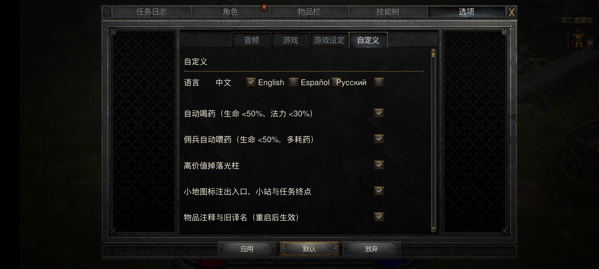
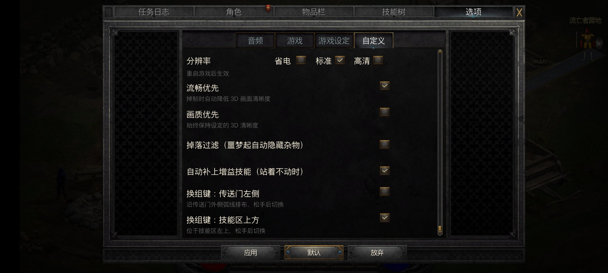

# 同步上游：做法与记录（最近一次 2026-10-21）

> **这份文档是什么（人话）**：每跟进一次上游（`jhaizhou-ops/d2r-mobile`）就更新一次——这次同步了什么、冲突怎么解的、合并后必须跟着改什么、哪些还没验。
> **给谁看**：下一次做同步的人（含 AI）。照着「§6 下次怎么同步」走，别从头再摸一遍。

---

## 0. 最新一次：2026-10-21（上游 4 个提交，到 `53e7c5b`）

### 0.1 这次同步了什么

- 上游 `9393b00..53e7c5b` 共 **4 个提交**，我们当时领先 **193** 条：`README.es.md`；Mac 打包 / 悬停 / 物品注释 /
  自动增益 / iCloud 启动 / Xcode 26.2 等社区修复（`d42b9d7`、`1ceaa6b`）；游戏内西语 esES/esMX（`6996690`）；
  游戏内俄语 + 可选 Mac VP8 电影解码（`53e7c5b`，`MOVIE.md`、`hle_movie.c`、`dm_movie_decode.c`）。
- 上游把**语言开关从布尔 `lang_en` 换成四项 `lang`**（0 中 / 1 英 / 2 西 / 3 俄），`ui_text.tsv` 从 4 列变 7 列
  （中文 / English / Español / Español MX / Русский / 用在哪），`dm_i18n.c` 改成按语言组（`DM_LG_*`）取串。
- 合并方式：**merge，不 rebase**。合并提交 `797ca2c`，合并前备份在分支 `backup/pre-upstream-sync-20261021`。

### 0.2 冲突（6 处，全是「上游结构 + 我们的 Android 区段」）

| 文件 | 上游 | 我们 | 解法 |
|---|---|---|---|
| `dm/host/dm_custom.c` | 语言行四项单选（`LANG_N`、`k_lang_box`），键 `lang` | `q_res` 分辨率行（键表下标 12）、`K_QRES/K_Q3D/K_TOUCH_SWAP` | 上游四项语言 + 我们的 `q_res`：键序 `lang..eco_fps, q_res(12), q3d(13)…touch_swap(16)` |
| `dm/ios/tools/touch_layout.py` | 语言行加 Español / Русский 两个框 | `_custom_res_row()`（`DM_TOUCH_RES_TIER=1` 时才有） | 四个语言框照留，分辨率行函数接在后面 |
| `dm/i18n/ui_text.tsv` | 7 列表（西 / 拉美西 / 俄） | 本地 8 条 Android 文案（`dmPickClassFirst`、`dmCustomQRes*`、`dmTcMain/dmTcSkill`） | 以上游 7 列为基准补回这 8 条（西 / 俄列一并补，拉美西留空 = 同 esES） |
| `dm/host/dm_i18n_tab.h` | 生成物，结构 `{k,zh,en,es,mx,ru}` | 手改不了 | 用 `dm_i18n.py --header` 从合并后的表重生成 |
| `README.md` / `README.zh-CN.md` | 加 Español 链接 | 加 Android 入口 | 两行都留 |

### 0.3 合并后跟着改的（编译器不拦，但会错）

1. **`ui_text.tsv` 新行必须填西语 / 俄语两列**：`dm_i18n.py` 见到空值直接 `SystemExit`（不像拉美西语可留空）。
   这次 8 条 Android 文案的 es/ru 是按语境补的（`Ahorro` / `Estándar` / `Alta` / `Habilidad` / `Навык` …），**没有母语审校**。
2. **`dm_i18n_tab.h` 不许手改**：改了表就重跑 `python3 dm/ios/tools/dm_i18n.py --header > dm/host/dm_i18n_tab.h`。
3. **键表下标与行序**：`dm_custom.c` 的 `k_keys` / `K_QRES/K_Q3D/K_TOUCH_SWAP` 必须和 `touch_layout.py` 的
   `_CUSTOM_ROWS` 一一对上（`test_touch_layout_options.py` 按 Android 口径查这个）。
4. **语言开关生效路径**：`hle_fs.c` 的 `settings_lang_apply()` 现在按 0…3 映射（中文组 / 英文 / 西语组 / 俄语）；
   安卓要靠构建定义的 `DM_ANDROID_SETTINGS_SEED` 才编进那一段。
5. `dm/host/dm_custom.h` 里语言键的注释已从 `lang_en` 改成 `lang`（上游忘了改）。

### 0.4 验证做到哪一步（2026-10-21，全绿）

| 项 | 结果 |
|---|---|
| `dm/android/build && ninja` | ✅ 27 个目标，`-Werror` 通过（含 `dm_custom.c`、`dm_i18n.c`、`hle_fs.c`） |
| `build_modules.sh` | ✅ 三个 patched.bin 与包内那份逐字节一致 |
| `DM_ASSETS_REUSE=1 gen_overlay.sh` | ✅ 覆盖层重出（`i18n_ui.json` 394 条，8 条新文案四语齐全） |
| `build_apk.sh` | ✅ 签名 APK 28,157,138 字节 |
| `sync_surface_audit.sh` | ✅ 冲突面 **50 → 50**（持平；文档里 43 是 10-18 那次的口径） |
| `scan_literals.py` / `dm_i18n.py --check` | ✅ 459 条白名单 / 394 条 |
| `test_touch_layout_options.py` / `test_touch_layout_language.py` | ✅ PASS |
| iOS 自定义页布局 | ✅ 与上游输出逐字一致（Android 才多 `q_res` 一行） |
| 真机（22081212C / Android 16 / 无线 adb） | ✅ 见下 |

**真机验过的（装新包 + 新覆盖层）：**
- 启动日志：`自定义设置：读盘 … lang=0`、`分辨率档读盘为 标准（q_res=1）`、`出图：按分辨率档算 → 2322x1080（tier=1）`，
  覆盖层被认出（`覆盖层在，按设计改写`）；全程无 FATAL / SIGSEGV / 【红】。
- 自定义页语言行：**中文 / English / Español / Русский 四项**，中文勾选正确；点 Español / English 各记一行
  `语言 → es/en（点「应用」生效）`。
- 自定义页「分辨率」行（Android 专属，位置在 eco_fps 与 q3d 之间）：省电 / 标准 / 高清 + 「重启游戏后生效」小字，
  标准档勾选；点「高清」→ `sw_custom.txt` 里 `q_res=2`、日志「已落盘」，点回「标准」→ `q_res=1`。
- 营地帧率 36–39 fps（标准档，与本文档记录一致）。




### 0.5 这次发现的问题

- ~~「Русский」在语言行里**折成两行**~~（`Русски` / `й`）：文字框 200 单位按英文/西语量的，西里尔字母更宽。
  **已修**：`touch_layout.py` 加平台开关 `DM_TOUCH_LANG_RU_WIDE`（`gen_overlay.sh` 里对安卓打开），俄语那一格的文字框
  从 1105 让到 1055、宽 200 → 250；iOS 不设这个变量，布局仍与研究上游逐字一致。真机复验：一行显示、勾选框仍对齐。
  `test_touch_layout_language.py` 现在两条都测（iOS 200 / 安卓 250）。若上游 iOS 包上也有这个折行，把开关去掉即可两平台共用。
- `dm_custom.c` 分辨率点选那段有两条重复日志（「已落盘」+「点应用生效」），是本地旧代码，不是这次合并带来的。
- 本机 `git fetch upstream` 走 ssh 会报 `/etc/ssh/ssh_config.d/20-systemd-ssh-proxy.conf` 属主不对；
  文档 §6 那条 `GIT_SSH_COMMAND="ssh -F $HOME/.ssh/config"` **确实能绕开**（已验），
  `git -c url.https://github.com/.insteadOf=git@github.com: fetch upstream` 也行。

---

> 下面 §1–§7 是 **2026-10-18** 那一次的内容，保留作历史记录；§6 的步骤仍然通用。

## 1. 这次同步了什么

- 上游 **10 个提交**，到 `9393b00`（含 tag `v1.0.18`）。我们当时领先 89 个提交。
- 合并方式：**merge，不 rebase**（领先 89 条，rebase 要解 89 次）。合并提交 `7185abd`；合并前状态备份在分支 `sync-backup-2026-10-18`。
- 上游这批的主要内容：
  - `46cb318` 新触摸外观与操作（`DmTouchControlArt.h`、`DmTouchOverlay.m`、新美术 `ControlArt/dm_mobile_socket.png`、`dm_touch_controls.c/h` 新布局与 API、自定义页新增「换组键在上」`touch_swap_above`）；
  - `6edec84` 空技能位边缘提亮（同上那套外观）；
  - `86b1315` nvn 图像步长修复（新 op `OP_COPY_IMAGE_STRIDE` + `nvn_copy_pitch.h`）；
  - `b84657b` 加载器保留未解析弱导入；`dc53e7a` 旧 CommitSaveData 走事务提交；`098d9f5` Mac 鼠标按下延迟；
  - `21cf97b` iPhone 原生全屏与受支持游戏启动；`3af961d` 打包留签名区；`9393b00` iOS 音频与其他 App 混音；README 两条。

## 2. 两个真冲突（都很小，两边都留）

| 文件 | 上游 | 我们 | 解法 |
|---|---|---|---|
| `dm/gfx/nvn/nvn_obj.h` | 枚举加 `OP_COPY_IMAGE_STRIDE` | `ANDROID-BEGIN/END` 区段（不在同一位置） | 上游那项插在 `OP_CLEAR_TEX` 之后、我们区段之前——正是文件注释里定的规矩 |
| `dm/gfx/nvn/hle_nvn.c` | 加 `nvnCommandBufferSetCopyImageStride` | `#ifdef __ANDROID__` 的 WaitSync / FenceSync / WaitEvent | 两边都留，上游那行紧跟 SetCopyRowStride |

其余双方都改过的 8 个文件（`dm_cursor.c`、`hle.c`、`hle_svc.c`、`loader.c`、`ui_text.tsv`、`dm_i18n_tab.h`、`touch_layout.py`、`patch_nso.py`）自动合上。

## 3. 合并后必须跟着改的（编译器不会拦你，但会挂）

1. **`nvn_vk.c` 补 `OP_COPY_IMAGE_STRIDE`**：操作码 switch 的 `default:` 是 `die("unimplemented NVN command opcode")`，不补的话游戏一调新函数就当场挂。补的时候压缩 / 非压缩两条 buffer→texture 路径都按层距算了（`0 = 紧排`，与上游 `nvn_copy_pitch.h` 同语义；非紧排时逐层各发一次 `VkBufferImageCopy`，因为 Vulkan 这条命令没有层距字段）。
2. **触摸层接上游新 API**（`touch_controls_android.c`）：
   - `dm_tc_set_safe_bottom(bottom)`：共享布局自己把技能弧抬起来，**取代**了原先手写的 `raise_skill_arc_locked`（两个都留会抬两次）；
   - `dm_tc_set_swap_above(...)`：自定义页新设置项，`tick()` 里轮询、变了就重排（对齐 iOS `refreshPortalBinding`）。
3. **`dm_i18n_tab.h`**：与合并后的 `ui_text.tsv` 复核一致（重跑生成器无差异）。
4. **摇杆浮动**：`nativeFrame` 按着时给 `joy_origin_x/y`（原来恒给静止位），Java 才画得出"底盘跟手"。iOS 那边读的就是 origin。

## 4. 验证做到哪一步

| 项 | 结果 |
|---|---|
| `dm/android/build && ninja` | ✅ |
| `build_modules.sh`（规则域 `touch-run-v4`） | ✅ main 49 行切点 / 36 行门（含表头） |
| `build_apk.sh` | ✅ 出包签名 |
| `sync_surface_audit.sh` | ✅ 冲突面 **43 → 43**（持平） |
| `dm/i18n/scan_literals.py` | ✅ 461 条全在白名单 |
| `dm/ios/tests/test_touch_layout_options.py`（上游新测试，不需要游戏文件） | ✅ PASS |
| `gen_overlay.sh` | ✅ 出覆盖层（见 §5 的开关） |
| `dm/host/tests` | ⛔ macOS 专用（`malloc/malloc.h`、`TargetConditionals.h`），Linux 跑不了，用安卓构建代验 |
| 真机（2026-10-18，Wi-Fi adb） | ✅ 见下面「真机验过的」 |

**真机验过的（合并 + 新覆盖层 + 新触摸外观，同一台机）：**
- 选角页 = 触屏版（右侧存档列表、居中「进入游戏」、「创建新角色」、无 A/B 提示）✅
- 进局、背包面板（页签/格子/说明框/「存放」/右上角关闭 X）✅
- 暂停菜单（选项 / 保存并退出 / 一键重开 / 分享诊断日志）✅
- 选项四页签 + 自定义页（语言勾在「中文」上）✅
- 自定义页新增的「换组键：传送门左侧 / 技能区上方」两格：切换 → 应用 → `sw_custom.txt` 写入 `touch_swap_above=1`
  → 日志 `触屏布局：换组键 挪到技能区上方（自定义页设置）` → Ⅰ 键当场挪位 ✅
- 新触摸外观：嵌槽金属边、银色技能图、空槽细边 + 十字、换组键 Ⅰ/Ⅱ ✅
- 底栏 v4：生命/法力球、经验条、Lv%、腰带四格与件数、金色十字 ✅
- 全程日志无 FATAL / die / D2Win 报错 ✅

## 5. 三个坑（前两个是构建环境，第三个是推覆盖层——这个会直接让游戏挂）

1. **`native_art` 的「PNG 重编码字节」校验跟 Pillow 版本绑死**：报 `dm_native_skill_0.png 解出的 PNG 与冻结的不一致（Pillow 版本？）`。
   原件哈希（SHA-256 / MD5）仍然校验得过，说明游戏文件没问题；差的是 Pillow 重新编码 PNG 的字节。本机 Pillow 12.3.0。
   → 只想按新布局重出覆盖层时，用加法开关 **`DM_ASSETS_REUSE=1`**（`gen_assets.py` 的 `ensure()`：产物齐了就沿用，不再按指纹重跑美术）。
   根本解法是二选一：把 Pillow 固定到出冻结值那一版，或按当前工具链重出 `native_art_manifest.json`——**都不属于同步该干的事**。
2. **`gen_hud_v4` 的 PC 版 2 倍素材目录不在**（`$DM_ROOT/data/assets-src/raw`）：缺了会回落到 Switch 半分辨率图（底栏 v4 会略糊）。这次因为用了 `DM_ASSETS_REUSE=1`，没有重出，所以没有影响。
3. **推覆盖层之后必须 `chmod -R 777`**（2026-10-18 真机踩过，花了一个小时二分）：
   `adb push` 建出来的 `overlay/data` 属主是 `shell:shell`、权限 `0770`，App（`u0_a214`）进不去那个目录 →
   覆盖层读不到 → 游戏在 `D2Win: Fatal failure during UISystem initialization` 直接挂（日志里还有一串 SIGSEGV）。
   **症状很容易被误判成"新覆盖层内容坏了"**：把整层覆盖层挪走游戏就正常。先看 `ls -la .../overlay/data` 的属主与权限。

## 6. 下次怎么同步（照抄）

```bash
# 0) 工作区要干净（上游也改的文件，脏着会被 git 拒）
git status --short

# 1) 备份 + 拉 + 合（用 merge，不要 rebase）
git branch -f sync-backup-$(date +%F) HEAD
GIT_SSH_COMMAND="ssh -F $HOME/.ssh/config" git fetch upstream --prune   # 本机 /etc/ssh 那个 systemd 配置坏了，必须绕开
git merge --no-ff --no-edit upstream/main

# 2) 解冲突：只看 git status 里 UU 的那几个；规矩是「上游的行留着 + 我们的 ANDROID 区段留着」

# 3) 合并后自检（照 §3 的清单逐条看上游这版动了哪些共享 API）

# 4) 验
dm/android/tools/sync_surface_audit.sh          # 冲突面只许降/持平；涨了在提交说明里写原因
cd dm/android/build && ninja && cd -
dm/android/tools/build_modules.sh && dm/android/tools/build_apk.sh
DM_ASSETS_REUSE=1 dm/android/tools/gen_overlay.sh   # 只重出覆盖层时（见 §5-1）
python3 dm/ios/tests/test_touch_layout_options.py
python3 dm/i18n/scan_literals.py

# 5) 上机：装包 + 推覆盖层（覆盖层目录先清空，别留旧数据档）
dm/android/tools/deploy_apk.sh
adb shell rm -rf /sdcard/Android/data/org.d2r.binaryprobe/files/d2r-mobile/diagnostics/overlay/*
adb push dm/android/build/romfs-overlay/. /sdcard/Android/data/org.d2r.binaryprobe/files/d2r-mobile/diagnostics/overlay/
adb shell chmod -R 777 /sdcard/Android/data/org.d2r.binaryprobe/files/d2r-mobile/diagnostics/overlay   # 少了这句游戏 UI 初始化就挂，见 §5-3
```

## 7. 新触摸外观的移植（2026-10-18）

上游 `46cb318` 把触摸外观整套换了（薄边嵌槽 + 浮动摇杆）。这件事**不在合并的机械范围里**，因为 `DmTouchControlArt.h` 是 CoreGraphics，安卓编不了——按方案文档 §2.1 第 11 条「逻辑参照移植」逐项翻成了 Java Canvas（`TouchControlsView.java`）：

| iOS | 安卓 |
|---|---|
| `dm_button_draw` | `buttonDraw()`（同渐变 / 同线宽 / 同 alpha） |
| `dm_socket_neutralize` | `socketDraw()` + `socketNeutral()`（Android 无 SATURATION 混合 → 去色副本 + 椭圆遮罩，等效） |
| `dm_joystick_base_draw` / `_thumb_draw` | `joystickBaseDraw()` / `joystickThumbDraw()` |
| `controlArt:` 缓存 | `controlArt()`（同 64 上限） |
| 图标阴影 | `shadowedIcon()`（离屏位图 + `setShadowLayer`） |
| 无图标退回 `lbl_*.png` | 直接贴 `hud_v4_ui/lbl_*.png` |
| 非技能格 `_circle` + 固定图标 | `circleCell()` + `fixedIcon()` |

- 新素材：`dm_mobile_socket.png` 由 `build_apk.sh` 拷进 `assets/`；`dm_native_circle/map/menu.png` 与 `sil_dm_native_skill_*.png` 本来就在。
- **已上机验过**（2026-10-18）：嵌槽底、银色技能图、空槽细边 + 十字、换组键、底栏 v4 都对得上；三个等效替代（无 SATURATION 混合 / 阴影算法不同 / luminosity 近似）在真机上没有肉眼可辨的偏差，暂不再调。
